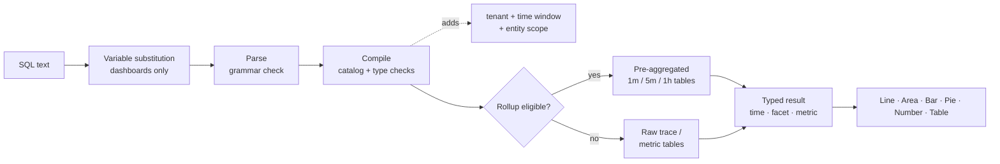

## 如何使用SQL进行查询：查询的机制 {#how-to-query-with-sql-the-mechanics-of-querying}

在使用任何工具之前，了解其工作原理会很有用。 本文档说明如何浏览数据，说明查询运行时发生的情况，并介绍从简单到复杂的示例查询。

### 数据探索

使用SQL的最佳方法是打开&#x200B;**浏览**，然后使用您自己的数据进行尝试。

>[!TIP]
>
> SQL是只读的。 它无法更改或删除数据，并且每个查询的范围都属于您的租户。

1. **在应用程序顶部的租户切换器中挑选客户**，SQL需要一个租户。
2. 打开&#x200B;**浏览**。 通过&#x200B;**可视化生成器**&#x200B;选项卡，您可以选择&#x200B;**来自** （实体）、**聚合**、**筛选器**、**Facet**&#x200B;和&#x200B;**时序**。 生成的SQL显示在下面。
3. 切换到&#x200B;**SQL**&#x200B;选项卡以直接编辑查询。 编辑器会在您键入时自动完成实体、属性和函数。
4. 打开右侧的&#x200B;**查询指南**&#x200B;面板，以浏览实体、属性类型和示例查询。 单击一个示例以加载它。
5. 单击&#x200B;**验证**&#x200B;以检查查询而不运行它，或单击&#x200B;**运行** (⌘/Ctrl + Enter)以查看结果。

首先键入`FROM`并选择实体，然后添加`SELECT`和属性：

```sql
FROM Transaction SELECT name, duration LIMIT 20
```

这是基本的&#x200B;**事件查询**。 它会返回20个入站请求，并显示每个请求的操作名称和持续时间。

现在使用&#x200B;**聚合**&#x200B;替换属性并将结果分组：

```sql
FROM Transaction SELECT count(*) FACET service
```

这会计算每个服务的请求数，向您显示正在报告的服务。

>[!IMPORTANT]
>
> **生成前发现。** 属性可用性取决于每个服务的检测方式。 首先在新租户上运行[发现查询](#101-data-discovery)，以查看哪些服务、主机、属性和量度实际包含数据。

### 查询的运行方式

运行查询时，可观察性分析：

1. **替换变量**，将`{{name}}`令牌替换为当前的仪表板变量选择。 此操作在浏览器中进行，仅在功能板中进行。
2. **分析**&#x200B;文本。 SQL语法之外的任何内容都会被拒绝，包括分号、原始SQL函数和子查询。
3. **编译**&#x200B;查询。 它将每个逻辑属性（例如`urlPath`）映射到其存储的表达式，并验证类型和函数。
4. **添加强制防护**：您的租户、时间窗口和实体的固定范围（例如，`Transaction`表示服务器仅跨越）。
5. **将**&#x200B;个符合条件的时间序列查询路由到预聚合的&#x200B;**汇总**&#x200B;表。 这是自动的，并且结果与原始数据匹配。
6. **以15秒超时和字节读取预算执行**&#x200B;查询，然后返回UI呈现的键入列（时间、方面、指标）。



### 结果形状

每个查询返回四个形状中的一个。 形状决定了哪些图表有意义。

| 形状 | 如何获取 | 默认`LIMIT` | 最佳可视化图表 |
| --------------- | ---------------------------------------------------- | --------------- | ------------------ |
| **公告牌** | 仅聚合，无`FACET`且无`TIMESERIES` | 1 | 数字 |
| **方面** | 聚合+ `FACET` | 10 | 条形图、饼图、表格 |
| **时间序列** | 聚合+ `TIMESERIES`（无论是否有`FACET`） | 5,000行 | 线条、区域、条形图 |
| **个事件** | 仅限原始属性 | 100 | 表 |

<a id="time-window-precedence"></a>

### 时间窗口优先级

| 查询运行位置 | 适用哪个窗口 |
| --------------------------------- | ---------------------------------------------------------------------------------- |
| **仪表板小组件** | 仪表板&#x200B;**时间选取器**。 查询中的`SINCE`/`UNTIL`被忽略。 |
| **添加构件预览** | **添加构件**&#x200B;对话框中的时间选取器。 |
| **浏览** | 全局时间选取器。 当选取器范围处于活动状态时，将忽略`SINCE`/`UNTIL`。 |
| **API没有显式范围** | 查询中的`SINCE`/`UNTIL`，默认使用上一个小时。 |

>[!NOTE]
>
> 由于选取器会在功能板和Explore中取胜，因此本指南通常会将`SINCE`排除在功能板查询之外。 应始终为查询定义时间选取器。
