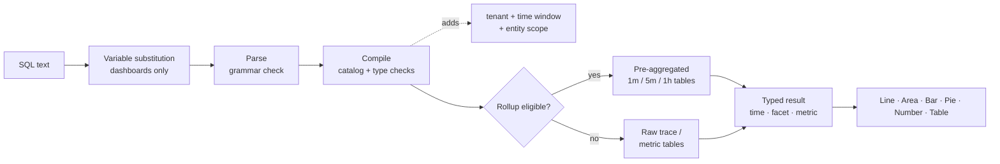

<a id="top"></a>

# Adobe可观察性分析功能板/查询文档

**Adobe可观察性分析查询语言(SQL)** — 在Adobe可观察性分析中查询、图表和仪表板。

|                |                                                                  |
| -------------- | ---------------------------------------------------------------- |
| **应用于** | **探索**&#x200B;和&#x200B;**仪表板**→分析UI （自定义仪表板） |
| **受众** | 知道SQL的工程师、SRE和高级用户 |

>[!TIP]
> 标记为`sql`的每个代码块都是SQL查询，您可以将其直接粘贴到&#x200B;**→浏览SQL**&#x200B;或&#x200B;**仪表板→添加SQL**→构件。

## 文档映射

| 分区 | 文档 | 您将了解的内容 |
| --------------- | ----------------------------------------------------------------------------------- | ------------------------------------------------------------------------------------------- |
| **开始** | [1. 开始使用SQL](#1-get-started-with-SQL-the-language-of-your-telemetry) | 什么是SQL、可以查询的内容、在何处使用它、基本规则 |
|                 | [2. 如何使用SQL](#2-how-to-query-with-SQL-the-mechanics-of-querying)进行查询 | 如何浏览数据、查询如何运行、运行示例 |
|                 | [3. 图表和仪表板](#3-charts-and-dashboards-visualizing-your-data) | 如何将查询转换为图表并分步构建功能板 |
| **引用** | [4. SQL引用](#4-SQL-reference) | 每个子句、函数和运算符，带示例 |
|                 | [5. 数据字典](#5-data-dictionary) | 可以查询的每个实体和属性 |
| **教程** | [6. 教程1：您的第一个查询](#6-tutorial-1-your-first-queries) | `SELECT`，`FROM`，`LIMIT`，总计，时间，`TIMESERIES`，`WHERE`，`FACET` |
|                 | [7. 教程2：控制您的数据](#7-tutorial-2-control-your-data) | 唯一值、最新/最早、百分比、百分点、标签、通配符、排序 |
|                 | [8. 教程3：推进您的仪表板](#8-tutorial-3-advance-your-dashboarding) | 条件聚合、Apdex、比率、直方图、公式、变量、节 |
|                 | [9. 教程4：高级函数](#9-tutorial-4-advanced-functions) | `stddev`，`derivative`，排名`latest`，合计份额，跨内容合成，量度发现 |
| **示例** | [10. 查询指南](#10-query-cookbook) | 按主题（包括AEM）列出的100多个现成查询 |
|                 | [11. 仪表板Blueprint](#11-dashboard-blueprints) | 包含每个小组件的查询的十个完整、复杂的仪表板 |
| **操作** | [12. 性能](#12-performance) | 汇总、查询预算以及如何快速保持功能板 |
|                 | [13. 疑难解答](#13-troubleshooting) | 每个错误消息、其含义以及如何修复它 |
|                 | [14. 附录](#14-appendix) | 限制、导出文件格式、单页备忘单 |

# 开始使用

## &#x200B;1. SQL入门：遥测语言

SQL是类似于SQL的可观察性分析数据的查询语言。 对于每个自定义仪表板小组件和&#x200B;**浏览**&#x200B;页面，它都是同样的语言，因此您可以构建团队需要的视图。

SQL与&#x200B;**实体**&#x200B;一起使用，这些实体是友好的逻辑视图，如`Transaction`、`Span`或`CpuUtilization`。 您从不直接查询存储表。 可观察性分析将每个SQL查询编译为安全、带参数的仓库查询。 它始终将查询的范围限定为您的租户和选定的时间范围。

```sql
SELECT count(*) AS requests FROM Transaction TIMESERIES AUTO
```

### 使用SQL可以做什么

使用SQL可以：

- **构建图表**&#x200B;吞吐量、错误率、延迟、Apdex、CPU、内存、JVM栈、磁盘和网络随时间变化的图表。
- **回答特定问题**，如“发布层上的哪些URL路径的p95最差？” 或“哪个下游域出现故障？”
- **通过从KPI向下钻取到单个请求和跟踪ID来调查事件**。
- **使用KPI、趋势、表格、公式、注释、节标题和变量构建功能板**。
- **使用Sling、JSP、JCR、Dispatcher和AEM属性分析GraphQL工作负载** (Adobe Experience Manager)。

SQL同时支持&#x200B;**事件查询**&#x200B;和&#x200B;**聚合查询**，前者返回单个请求行，后者返回总计、百分比、比率、划分和时间序列。

>[!TIP]
> **仪表板→创建仪表板**&#x200B;中的模板完全由SQL生成。 打开带有铅笔图标的任意模板构件，以查看其查询并从中学习。

### 您可以查询的内容

SQL可以查询四个系列的数据。 完整列表位于[数据字典](#5-data-dictionary)中。

| 家庭 | 实体 | 典型问题 |
| ------------------------------------ | ------------------------------------------------------------------------------------------------------------------------------------------------------------------ | -------------------------------------------------------------------- |
| **跟踪(APM)** | `Transaction` （入站请求）、`AppRequest` （请求+消息使用者）、`Span` （每个跨度） | 吞吐量、延迟、错误、Apdex、下游调用、AEM代码路径 |
| **已监管的主机和运行时量度** | `CpuUtilization`、`MemoryUtilization`、`LoadAverage5m`、`DiskUtilization`、`NetworkReceiveRate`、`JvmHeapUsed`、`JvmThreadCount`、`DispatcherRequestRate`等 | 饱和度、容量、JVM运行状况、调度程序负载 |
| **通用量度** | `MetricGauge`, `MetricSum` | 按名称、度量发现分类的任何OpenTelemetry度量 |
| **预聚合跨度组合** | `SpanBreakdown` | 构成事务处理的子工序 |

>[!NOTE]
> 日志、警报定义和清单关系不可用。

### 使用SQL的位置

| 位置 | 如何打开它 | 它的用途 |
| ----------------------- | ------------------------------------------------------------------------------ | ------------------------------------------------------------------------------------------------------------------------------------------------------------------------------------ |
| **浏览** | 左导航→**浏览** | 临时分析。 使用&#x200B;**可视化生成器**&#x200B;或&#x200B;**SQL**&#x200B;选项卡，**验证**，然后&#x200B;**运行** (⌘/Ctrl + Enter)。 包括&#x200B;**历史记录**&#x200B;和&#x200B;**已保存**&#x200B;的查询以及&#x200B;**查询指南**&#x200B;面板。 |
| **仪表板** | 左导航→**仪表板**→打开或创建仪表板→**添加小组件** | 组合到仪表板中的持久性图表、KPI和表。 |
| **公式小组件** | **将构件添加→公式** | 将2-6个SQL查询与算术运算（比率、预留空间、烧录率）相结合。 |
| **仪表板变量** | **+变量从查询→** | 从SQL `FACET`查询的不同值填充选取器。 |
| **查询检查** | 将鼠标悬停在图表→检查查询上 | 查看内置图表或仪表板图表后面的SQL。 |

### SQL查询结构

SQL遵循基于子句的语法。 此查询计算选定窗口中的所有入站请求：

```sql
SELECT count(*) FROM Transaction
```

下面是所有可用的子句：

```text
SELECT  function(attribute) [FILTER (WHERE condition)] [AS alias] [, ...]
        | attribute [AS alias] [, ...]
FROM    Entity
  [WHERE      condition [AND | OR ...]]
  [FACET      attribute [, attribute ...]]        -- up to 5
  [SINCE      n unit [AGO]]
  [UNTIL      NOW | n unit [AGO]]
  [TIMESERIES AUTO | MAX | n unit]
  [ORDER BY   alias [ASC | DESC]]
  [LIMIT      number]                              -- 1 to 5000
```

SQL遵循以下规则：

| 规则 | 详细信息 |
| ---------------------------- | ------------------------------------------------------------------------------------------------------------------------------------------------------------------------------------ |
| **必需的子句** | `SELECT`和`FROM`是必需的。 其他每个子句都是可选的。 您可以以下列任一项开头： `FROM Transaction SELECT count(*)`也有效。 |
| **子句顺序** | `FROM`之后的子句可以按任意顺序出现。 每个子句只能出现一次。 |
| **查询大小** | 查询大小必须等于或小于4 KB。 |
| **区分大小写** | 关键字、函数名、实体名和属性名是&#x200B;**不区分**&#x200B;大小写。 字符串值&#x200B;**区分大小写(`'Error'`≠`'error'`)**。 |
| **字符串** | 使用单引号： `WHERE status = 'Error'`。 要包含引号，请加倍引号： `'O''Brien'`。 不接受双引号。 |
| **文本** | 字符串、数字（包括负数和小数）、`TRUE`、`FALSE`、`NULL`。 |
| **属性名称** | 名称可以包含字母、数字、`_`和`.`（例如`http.statusCode`）。 无需回退。 |
| **聚合与属性** | 查询可以选择原始属性（事件列表）或聚合，但绝不能同时选择两者。 若要分组，请使用`FACET`。 |
| **时间窗口** | 默认值为上一小时。 最长为31天。 在功能板和浏览器中，**时间选取器**&#x200B;设置窗口（请参阅[时间窗口](#time-window-precedence)）。 |
| **不支持** | 分号、注释、子查询、联接、`SELECT *`、`SELECT`、`HAVING`、`COMPARE WITH`中的属性之间的数学。 有关备选方案，请参阅[SQL没有做什么](#what-SQL-doesnt-do)。 |

### 后续步骤

- [如何使用SQL进行查询](#2-how-to-query-with-SQL-the-mechanics-of-querying)：浏览数据并了解查询的运行方式。
- [图表和仪表板](#3-charts-and-dashboards-visualizing-your-data)：可视化您的结果。
- [教程1：您的第一个查询](#6-tutorial-1-your-first-queries)：动手演练。
- [SQL引用](#4-SQL-reference)：完整语法、子句和函数。

[↑回顶部](#top)

## &#x200B;2. 如何使用SQL进行查询：查询的机制

在使用任何工具之前，了解其工作原理会很有用。 本文档说明如何浏览数据，说明查询运行时发生的情况，并介绍从简单到复杂的示例查询。

### 数据探索

使用SQL的最佳方法是打开&#x200B;**浏览**，然后使用您自己的数据进行尝试。

>[!TIP]
> SQL是只读的。 它无法更改或删除数据，并且每个查询的范围都属于您的租户。

1. **在应用程序顶部的租户切换器中挑选客户**，SQL需要一个租户。
2. 打开&#x200B;**浏览**。 通过&#x200B;**可视化生成器**&#x200B;选项卡，您可以选择&#x200B;**来自** （实体）、**聚合**、**筛选器**、**Facet**&#x200B;和&#x200B;**时序**。 生成的SQL显示在下面。
3. 切换到&#x200B;**SQL**&#x200B;选项卡以直接编辑查询。 编辑器会在您键入时自动完成实体、属性和函数。
4. 打开右侧的&#x200B;**查询指南**&#x200B;面板，以浏览实体、属性类型和示例查询。 单击一个示例以加载它。
5. 单击&#x200B;**验证**&#x200B;以检查查询而不运行它，或单击&#x200B;**运行** (⌘/Ctrl + Enter)以查看结果。

首先键入`FROM`并选择实体，然后添加`SELECT`和属性：

```sql
FROM Transaction SELECT name, duration LIMIT 20
```

这是基本的&#x200B;**事件查询**。 它会返回20个入站请求，并显示每个请求的操作名称和持续时间。

现在使用&#x200B;**聚合**&#x200B;替换属性并将结果分组：

```sql
FROM Transaction SELECT count(*) FACET service
```

这会计算每个服务的请求数，向您显示正在报告的服务。

>[!IMPORTANT]
> **生成前发现。** 属性可用性取决于每个服务的检测方式。 首先在新租户上运行[发现查询](#101-data-discovery)，以查看哪些服务、主机、属性和量度实际包含数据。

### 查询的运行方式

运行查询时，可观察性分析：

1. **替换变量**，将`{{name}}`令牌替换为当前的仪表板变量选择。 此操作在浏览器中进行，仅在功能板中进行。
2. **分析**&#x200B;文本。 SQL语法之外的任何内容都会被拒绝，包括分号、原始SQL函数和子查询。
3. **编译**&#x200B;查询。 它将每个逻辑属性（例如`urlPath`）映射到其存储的表达式，并验证类型和函数。
4. **添加强制防护**：您的租户、时间窗口和实体的固定范围（例如，`Transaction`表示服务器仅跨越）。
5. **将**&#x200B;个符合条件的时间序列查询路由到预聚合的&#x200B;**汇总**&#x200B;表。 这是自动的，并且结果与原始数据匹配。
6. **以15秒超时和字节读取预算执行**&#x200B;查询，然后返回UI呈现的键入列（时间、方面、指标）。



### 结果形状

每个查询返回四个形状中的一个。 形状决定了哪些图表有意义。

| 形状 | 如何获取 | 默认`LIMIT` | 最佳可视化图表 |
| --------------- | ---------------------------------------------------- | --------------- | ------------------ |
| **公告牌** | 仅聚合，无`FACET`且无`TIMESERIES` | 1 | 数字 |
| **方面** | 聚合+ `FACET` | 10 | 条形图、饼图、表格 |
| **时间序列** | 聚合+ `TIMESERIES`（无论是否有`FACET`） | 5,000行 | 线条、区域、条形图 |
| **个事件** | 仅限原始属性 | 100 | 表 |

<a id="time-window-precedence"></a>

### 时间窗口优先级

| 查询运行位置 | 适用哪个窗口 |
| --------------------------------- | ---------------------------------------------------------------------------------- |
| **仪表板小组件** | 仪表板&#x200B;**时间选取器**。 查询中的`SINCE`/`UNTIL`被忽略。 |
| **添加构件预览** | **添加构件**&#x200B;对话框中的时间选取器。 |
| **浏览** | 全局时间选取器。 当选取器范围处于活动状态时，将忽略`SINCE`/`UNTIL`。 |
| **API没有显式范围** | 查询中的`SINCE`/`UNTIL`，默认使用上一个小时。 |

>[!NOTE]
> 由于选取器会在功能板和Explore中取胜，因此本指南通常会将`SINCE`排除在功能板查询之外。 应始终为查询定义时间选取器。

### SQL查询示例

下面是一个更完整的示例。 对于此查询：

- 您选择`Transaction`作为实体。
- 您使用`SELECT`计算第95百分位数持续时间。
- 您使用`FACET`按服务对结果分组。
- 您使用`TIMESERIES AUTO`在自动调整大小的间隔内绘制数据。

```sql
FROM Transaction SELECT percentile(duration, 95) AS p95 FACET service TIMESERIES AUTO
```

这会在折线图上为每个服务生成一行，默认显示10个最繁忙的服务。

单击下面的每个示例以展开它。

<details>
<summary><strong>入站请求的基本查询</strong></summary>

所有入站请求的平均响应时间（以毫秒为单位）：

```sql
SELECT average(duration) FROM Transaction
```

</details>

<details>
<summary><strong>包含点的属性名称</strong></summary>

点状名称不需要引号：

```sql
SELECT count(*) FROM Transaction WHERE http.statusCode >= 500 FACET http.route
```

</details>

<details>
<summary><strong>查询返回多个列</strong></summary>

一个查询中的多个聚合会成为表中的列：

```sql
SELECT count(*) AS requests, average(duration) AS avgMs, percentile(duration, 95) AS p95, max(duration) AS maxMs FROM Transaction FACET service
```

</details>

<details>
<summary><strong>一次条件聚合</strong></summary>

总计、错误和5xx并排：

```sql
SELECT count(*) AS total, count(*) FILTER (WHERE status = 'Error') AS errors, count(*) FILTER (WHERE http.statusCode >= 500) AS http5xx FROM Transaction FACET service
```

</details>

<details>
<summary><strong>查询策划的指标</strong></summary>

一段时间内每台主机的平均CPU数：

```sql
SELECT average(value) AS cpu FROM CpuUtilization FACET host TIMESERIES AUTO
```

</details>

<details>
<summary><strong>按名称</strong>查询任何OpenTelemetry度量</summary>

将`MetricGauge` / `MetricSum`用于没有策划实体的量度：

```sql
SELECT latest(value) AS bytesUsed FROM MetricSum WHERE metric = 'jvm.memory.used' FACET host, pool
```

</details>

<a id="what-SQL-doesnt-do"></a>

### SQL不能执行的操作

SQL故意很小。 这保证了查询的安全性、快速性和租户隔离性。 当您需要其中一项功能时，请使用替代功能。

| 功能 | 状态 | 替代 |
| ------------------------------------------- | ------------- | ------------------------------------------------------------------------------------------------------------ |
| `SELECT *` | 不受支持 | 列出您需要的属性： `SELECT timestamp, name, duration, traceId …`。 |
| 混合原始属性和聚合 | 不受支持 | 使用`FACET attr`或`latest(attr)` / `earliest(attr)`。 |
| `SELECT`中的数学(`a - b`， `count(*) / 60`) | 不受支持 | **公式**&#x200B;小组件（仪表板）。 |
| 联接和子查询 | 不受支持 | **公式**&#x200B;构件，或两个并排构件。 |
| `HAVING` | 不受支持 | `ORDER BY alias` + `LIMIT`. |
| `COMPARE WITH` | 不受支持 | 更改时间选取器，或将两个小组件放在不同的选项卡上。 |
| `FACET CASES` | 不受支持 | 每个案例一个`count(*) FILTER (WHERE …)`列（请参阅[教程3](#83-group-values-into-cases-with-filter)）。 |
| `histogram()` | 不受支持 | 分段`FILTER`列（请参阅[教程3](#84-build-a-latency-histogram)）。 |
| `uniques()` / `keyset()` | 不受支持 | `FACET attr LIMIT n`列出了不同的值。 发现查询列出量度和填充的属性。 |
| `RLIKE` （正则表达式） | 不受支持 | 包含`%`和`_`通配符的`LIKE` / `NOT LIKE`，或`IN (…)`。 |
| 评论(`--`， `//`， `/* */`) | 不受支持 | 将备注放入小组件标题或&#x200B;**文本**&#x200B;小组件中。 |
| `SINCE`中的绝对日期 | 不受支持 | 使用时间选取器的绝对范围。 |
| 类型转换(`numeric()`， `string()`) | 不需要 | 在目录中键入属性。 |

[↑回顶部](#top)

## &#x200B;3. 图表和仪表板：可视化您的数据

查询可查找您需要的信息。 图表和仪表板可让这些信息对您的组织有所帮助。 本文档说明如何将SQL结果变成图表，以及如何构建、组织和共享功能板。

### 图表

每个SQL结果都可以呈现为六种图表类型之一。

| 图表类型 | 将其用于 | 查询形状 |
| --------------- | --------------------------------------------------- | ----------------------------------------------- |
| **行** | 随时间变化的趋势；每个Facet值一行 | 聚合+ `TIMESERIES` |
| **区域** | 随时间变化的数量，例如按服务统计的吞吐量 | 聚合+ `TIMESERIES` |
| **栏** | 比较类别；稀疏时间序列 | 聚合+ `FACET` (± `TIMESERIES`) |
| **饼图/圆环图** | 整体份额（状态代码组合、按层流量） | 一个聚合+ `FACET`，少数值 |
| **数字** | 单个KPI，具有可选的颜色阈值 | 广告牌（仅限聚合） |
| **表格** | 每个组或事件列表有多个聚合 | 多个聚合+ `FACET`或原始属性 |

在功能板上显示构件后，您可以：

- **编辑**&#x200B;其查询、标题、图表类型和单位（铅笔图标）。
- **复制**&#x200B;它以创建变体，如用于另一层的相同图表。
- **下载当前行的CSV**，或以2×分辨率下载&#x200B;**PNG**。
- **拖动手柄**，然后从右下角&#x200B;**调整大小**。

### 仪表板

图表本身工作正常，但仪表板将它们汇集在一起。 仪表板是&#x200B;**选项卡**&#x200B;的已命名租户范围的集合。 每个选项卡是一个&#x200B;**小组件**&#x200B;的12列网格。

| 概念 | 含义 |
| --------------- | ------------------------------------------------------------------------------------------------------------------------------- |
| **仪表板** | 1-40个选项卡的命名集合，为所选租户存储在服务器端。 |
| **选项卡** | 一个小组件网格（最多200个）。 用铅笔重命名它，用×删除它，添加一个包含&#x200B;**+**&#x200B;的铅笔。 必须至少保留一个选项卡。 |
| **小组件** | **单个查询**、**公式**&#x200B;或&#x200B;**文本**（注释或可折叠节标题）。 |
| **变量** | 网格上方的选取器。 其值作为`{{name}}`注入。 |
| **时间选取器** | 仪表板上每个小部件的窗口。 |

### 逐步创建功能板

#### 步骤1：开始之前

- **在租户切换器中选择单个客户**。 选择&#x200B;**所有帐户**&#x200B;时，**创建仪表板**&#x200B;被禁用。 无法针对演示租户运行SQL。
- **角色。** 具有仪表板访问权限的任何人都可以添加、编辑和保存构件。 创建或编辑&#x200B;**变量**&#x200B;以及检查构件查询时，限制为&#x200B;**组织管理员**&#x200B;和&#x200B;**超级管理员**。

#### 第2步：创建功能板

1. 在左侧导航中打开&#x200B;**功能板**。
2. 单击&#x200B;**创建仪表板**。
3. 选择一个起点：

   | 选项 | 您获得的内容 |
   | ---------------------------- | -------------------------------------------------------------------------------------------------------- |
   | **生成自定义仪表板** | 带有一个选项卡的空仪表板。 |
   | **CPU基础知识** | 托管和处理CPU (user/system/iowait/steke)、吞吐量、负载、Apdex。 |
   | **多功能一体机概述** | KPI（卷、错误百分比、Apdex、p95）、错误/流量Pie、CPU/内存表、JVM线程、操作缓慢。 |
   | **热门事务** | Apdex、按操作划分的p95、每主机负载/CPU、具有跟踪ID的最慢事务、HTTP错误细分。 |

4. 输入&#x200B;**名称**&#x200B;并确认。 仪表板画布随即打开。

#### 步骤3：了解画布

| 区域 | 控件 |
| ---------------------------- | --------------------------------------------------------------------------------------------------------- |
| **顶部栏** | **添加小组件**、**指南**（应用程序内备忘单）、**导入**、**导出**、**保存**、时间选取器并刷新 |
| **变量栏** | 租户徽章，每个变量一个选取器，**+变量** （管理员） |
| **选项卡栏** | 切换选项卡；重命名（铅笔）、删除(×)、添加(+) |
| **网格** | 12列。 拖动小部件通过手柄，从角调整大小（最小为2×2）。 |
| **小组件标头** （悬停时） | 下载CSV、下载PNG、编辑、复制、删除、拖动手柄 |

>[!IMPORTANT]
> **保存是显式的。** 在单击&#x200B;**保存**&#x200B;之前，布局更改、新小组件、选项卡和变量将保留在浏览器中。 按钮显示&#x200B;_正在保存……→已保存_，或&#x200B;_保存失败_（请参阅[疑难解答](#13-troubleshooting)）。

#### 步骤4：添加构件

单击&#x200B;**添加构件**。 该对话框具有三种模式：**单一查询**、**公式**&#x200B;和&#x200B;**文本**。 它还拥有自己的时间选取器，因此您可以在任意窗口上预览构件。

**选项A：生成器（无代码）**

1. _（可选）_ **从帮助程序开始**：从57个预设中选择一个，这些预设分组为Golden signal、APM、AEM、Transactions、Traces &amp; span、Infrastructure、Publishers、JVM &amp; runtime和Data Discovery。 预设会填充标题、查询、图表类型和单位。
2. **节目**：选择`Count`、`Average`、`Percentile`（及其级别）、`Sum`、`Min`、`Max`或`Unique count`，然后选择一个属性。
3. **来自**：选择实体。
4. **筛选器**：添加`attribute operator value` (`=`、`!=`、`>`、`<`、`>=`、`<=`、`LIKE`)的行。 所有行均与`AND`合并。
5. **分组依据**：选择一个Facet属性，并&#x200B;**前N**&#x200B;以仅保留最繁忙的系列。
6. **超时**：打开`TIMESERIES`，每N分钟&#x200B;**存储段大小为**。
7. 检查表单下生成的SQL，然后单击&#x200B;**运行查询**。

**选项B： SQL编辑器**

1. 将切换从&#x200B;**生成器**&#x200B;切换到&#x200B;**SQL**。 编辑现有构件时，始终会在SQL中打开。
2. 键入或粘贴查询。 编辑器从Live目录自动完成。
3. 使用&#x200B;**查询指南**&#x200B;面板浏览实体、属性和示例。
4. 单击&#x200B;**运行查询**。 您将看到&#x200B;_`<Entity>`查询有效_、实时预览和摘要(`N rows · N time points · N groups`)。 少于三个时间点时出现&#x200B;_稀疏序列_&#x200B;警告。

>[!TIP]
> 生成器包含最常见的查询。 为`apdex`、`percentage`、`rate`、`FILTER`、多个聚合、`OR`、`IN`、多个Facet或`ORDER BY`切换到SQL。

#### 步骤5：配置外观

| 字段 | 注释 |
| --------------------- | ----------------------------------------------------------------------------------------------------------------------------------------------------------------------- |
| **标题** | 最多200个字符。 可以包含`{{variable}}`个令牌。 |
| **图表类型** | `Line`, `Area`, `Bar`, `Pie / Donut`, `Number`, `Table`. 建议在每次运行后使用一种图表类型，直到您自己选择一个图表类型为止。 |
| **单位** | 可选；最多40个字符(`ms`， `%`， `req/s`， `MB`， `bytes`)。 将其留空以使用推断的单位（例如`duration`为`ms`，`CpuUtilization`为`%`）。 |
| **颜色阈值** | 仅限数字小组件。 最多10个格式为&#x200B;_且大于或等于`value`的带→绿色/琥珀色/红色_。 最高匹配频带wins。 |

#### 步骤6：保存构件，然后保存仪表板

仅在运行返回数据后启用&#x200B;**保存构件**。 新构件为6列×3行，每行压缩两个。 排列它们，然后单击顶部栏中的&#x200B;**保存**。

### 选择正确的图表

| 查询形状 | 最佳图表 | 原因 |
| ------------------------------------------------- | ------------------- | ---------------------------------------------- |
| 一个聚合，无`FACET`，无`TIMESERIES` | **数字** | 单个KPI图块；添加阈值。 |
| 聚合+ `TIMESERIES` | **行** / **区域** | 趋势；每个Facet值一个系列。 |
| 聚合+ `FACET`（少数值） | **条形图** / **饼图** | 比较类别；整体份额的饼图。 |
| 多个聚合+ `FACET` | **表格** | 每个聚合都成为一列。 |
| 原始属性 | **表格** | 事件列表。 |
| 对稀疏数据进行聚合+ `FACET` + `TIMESERIES` | **栏** | 读起来比条条条框框框框框框框框框框框框框框框框框框框框框框框框框框框框框框框框框框框框框框框框框框框框框框框框框框框框框框框框框框框框框框框框框框框框框框框框框框框框框框框框框框框框框框框框框框框框框框框框框框框框框框框框框框框框框框框框框框框框框框框框框框框框框框框框框框框框框框框框框框框框框框框框框框框框框框框框框框框框框框框框框框框框框框框框框框框框框框框框框框框框框框框框框框框框框框框框框框框框框框框框框框框框框框框框框框框框框框框框框框框框框框框框框框框框框框框框框框框框框框框框框框框框框框框框框框框框框框框框框框框框框框框框框框框框框框框框框框框框框框框框框框框框框框框框框框框框框框框框框框框框框框框框框框框框框框框框框框 |

当数字小部件的单行带有文本值（例如`latest(host)`）时，该小部件将其显示为子标题。

### 文本小组件：注释和节标题

**添加小部件→文本**：

- **注意**：纯文本（最多4,000个字符，保留空白行）。 将其用于Runbook链接、所有者和SLO定义。 `{{variables}}`已呈现。
- **节标题**：勾选&#x200B;_使其成为节标题_。 它横跨整个宽度，其V形标记折叠其下方的每个小组件，直到下一节标题。 将其用于&#x200B;**PUBLISH**、**AUTHOR**&#x200B;和&#x200B;**DISPATCHER**&#x200B;等分组。

>[!TIP]
> 以`- PUBLISH`或`- AUTHOR`结尾的小组件标题将获得细微的颜色提示，这可让AEM功能板更易于按层扫描。

### 时间选取器

- 它为&#x200B;**every**&#x200B;构件和查询驱动变量选项设置窗口。
- 它在构件查询中覆盖`SINCE` / `UNTIL`。
- 最大时段为&#x200B;**31天**。
- `TIMESERIES AUTO`根据窗口调整其存储段大小。
- 每个构件的子标题显示实际应用的窗口，例如&#x200B;_自1小时前_&#x200B;起。
- 结果缓存了30秒。 使用“刷新”按钮强制重新运行。

### 变量

变量允许一个仪表板同时为多个上下文提供服务，例如一个服务、环境或阈值。 [教程3](#87-make-dashboards-reusable-with-variables)对这些主题进行了深入介绍。

>[!WARNING]
> **当前内部版本中的已知限制：** `{{variables}}`在小组件&#x200B;**标题**&#x200B;和&#x200B;**文本小组件**&#x200B;中工作。 在小部件&#x200B;**SQL**&#x200B;内部，它们在仪表板中呈现，但&#x200B;**添加小部件**&#x200B;预览和服务器端&#x200B;**保存**&#x200B;检查拒绝具有`Unexpected character '{'`的原始`{{name}}`令牌。 在解决此问题之前，请在构件查询中使用文本值，并使用&#x200B;**复制**&#x200B;来生成变体。

### 公式小组件

公式以算术方式组合了2-6个命名SQL查询，例如`(errors / total) * 100`。 当KPI需要多个查询（例如比率、净空空间、比率总和或燃速）时，请使用其中一个查询。 请参阅[教程3](#86-combine-queries-with-formula-widgets)。

### 共享、导出和导入

| 操作 | 作用 |
| ------------- | ------------------------------------------------------------------------------------------------------------------------------------------------------------------------- |
| **保存** | 保留名称、选项卡、小组件、布局和变量。 每个Widget查询在服务器端重新验证；一个无效的Widget会导致整个保存失败。 |
| **导出** | 下载`<dashboard-name>.json`（选项卡、小组件、变量）。 |
| **导入** | 将JSON导出&#x200B;**加载到打开的仪表板**，并替换其选项卡和变量。 然后单击&#x200B;**保存**。 提示：首先创建一个空仪表板，然后导入其中。 |
| **CSV / PNG** | 从构件标题下载每个构件。 |

>[!TIP]
> 通过导出和导入，您可以在Git中控制功能板的版本，并将功能板从一个客户提升到另一个客户。 [附录](#142-export-file-format)中介绍了文件格式。

### 仪表板和图表性能提示

- **对大型结果集使用表**，而不是条形或多系列线。
- **将繁忙的报告面板拆分为选项卡。** 仅运行可见选项卡的小部件。
- **始终`LIMIT`多面查询**，尤其是高基数属性，如`urlPath`、`traceId`和`jcr.path`。
- **对低基数属性(`service`、`kind`、`status`)进行早期筛选**。
- **与固定小存储桶相比，更喜欢`TIMESERIES AUTO`**，并避免使用`TIMESERIES MAX`，除非超过几分钟。
- **为汇总设计长期趋势。** 查看[性能](#12-performance)。

[↑回顶部](#top)

# 引用

## &#x200B;4. SQL引用

本参考介绍了SQL语法、子句、函数和运算符。 展开每个条目以查看详细信息和示例。

**在此文档中：** [查询组件](#41-query-components) · [必需的子句](#42-required-clauses) · [可选子句](#43-optional-clauses) · [聚合器函数](#44-aggregator-functions) · [运算符和条件](#45-operators-and-conditions) · [类型处理](#46-type-handling-blank-vs-null) · [SQL到SQL](#47-translate-sql-to-SQL) · [NRQL到SQL](#48-translate-nrql-to-SQL)

### 4.1查询组件

```text
SELECT <select-item> [, <select-item> ...]
FROM   <Entity>
[WHERE      <condition>]
[FACET      <attribute> [, <attribute> ...]]          -- up to 5
[SINCE      <n> <unit> [AGO]]
[UNTIL      NOW | <n> <unit> [AGO]]
[TIMESERIES AUTO | MAX | <n> <unit>]
[ORDER BY   <alias-or-selected-name> [ASC | DESC]]
[LIMIT      <1..5000>]

<select-item> := <function>(<args>) [FILTER (WHERE <condition>)] [AS <alias>]
               | <attribute> [AS <alias>]
<unit>        := second | seconds | minute | minutes | hour | hours | day | days | week | weeks
```

>[!NOTE]
> 上述`--`注释仅为文档。 SQL本身不接受注释。

### 4.2必需条款

<details>
<summary><code>SELECT</code> — 要返回的内容</summary>

`SELECT`列出了&#x200B;**原始属性** （事件查询）或&#x200B;**聚合器函数** （聚合查询）。 你不能把两者混在一起。

| 表单 | 示例 | 结果 |
| ------------ | -------------------------------------------------- | ------------------------------------------------- |
| 属性 | `SELECT timestamp, name, duration` | 单个事件的行数（默认为100） |
| 聚合 | `SELECT count(*), average(duration)` | 每个聚合一个值（每个方面/时段） |
| 带有别名 | `SELECT count(*) AS requests` | 列标签`requests` |
| 带引号的别名 | `SELECT percentile(duration, 95) AS 'p95 latency'` | 带空格的标签 |

事件列表：

```sql
SELECT timestamp, service, name, duration, status, traceId FROM Transaction WHERE status = 'Error' LIMIT 50
```

多个聚合：

```sql
SELECT count(*) AS requests, average(duration) AS avgMs, max(duration) AS maxMs FROM Transaction
```

规则：

- 不支持`SELECT *`。 列出所需的属性。
- 不支持属性或聚合(`sum(a) / count(*)`)之间的数学运算。 使用[公式小组件](#86-combine-queries-with-formula-widgets)。
- 混合属性和聚合失败，因为&#x200B;_原始属性不能与聚合混合；请使用FACET对结果_&#x200B;进行分组。

</details>

<details>
<summary><code>FROM</code> — 要查询的实体</summary>

`FROM`从[数据字典](#5-data-dictionary)中恰好为&#x200B;**一个**&#x200B;实体命名。 实体名称不区分大小写。

```sql
SELECT count(*) FROM Transaction
```

```sql
FROM Span SELECT count(*) FACET kind
```

每个实体都有一个固定的范围。 例如，`Transaction`始终是服务器跨度，`CpuUtilization`始终是CPU忙碌量度，其中`value`已转换为百分比。 不能在单个查询中查询多个实体。 若要合并实体，请使用[公式小组件](#86-combine-queries-with-formula-widgets)。

</details>

### 4.3任择条款

<details>
<summary><code>AS</code> — 标记列</summary>

使用`AS`为聚合或属性提供一个可读的名称。 别名将变为列标题、图例标签以及您在`ORDER BY`中引用的名称。

```sql
SELECT count(*) AS requests, percentile(duration, 95) AS p95 FROM Transaction FACET service ORDER BY p95 DESC LIMIT 10
```

为带有空格的标签使用单引号字符串：

```sql
SELECT percentile(duration, 95) AS 'p95 latency (ms)' FROM Transaction TIMESERIES AUTO
```

</details>

<details>
<summary><code>FACET</code> — 组结果</summary>

`FACET`最多按&#x200B;**5**&#x200B;个属性（如SQL `GROUP BY`）对结果分组。

```sql
SELECT count(*) FROM Transaction FACET service, http.method, http.statusCode LIMIT 30
```

| 查询 | `LIMIT n`的含义 | 默认 |
| ---------------------------- | ----------------------------------------------------------------------------------------------------------------------------- | --------------------------------- |
| 不带`TIMESERIES`的`FACET` | 行数 | 10 |
| `FACET`与`TIMESERIES` | **前n个系列**，按整个窗口中的第一个聚合的总和排名。 这些系列的每一段时间都会保留。 | 所有系列（上限为5,000行） |

多面时间序列，前5项：

```sql
SELECT count(*) AS requests FROM Transaction FACET service TIMESERIES AUTO LIMIT 5
```

Facet值可以是字符串或数字。 空白字符串构成他们自己的组。 通过`WHERE attr != ''`排除它们。

</details>

<details>
<summary><code>FILTER</code> — 条件聚合</summary>

将`FILTER (WHERE condition)`附加到任何聚合以对该行的子集进行计算。 这使您能够一次性比较多个条件。

```sql
SELECT count(*) AS total, count(*) FILTER (WHERE status = 'Error') AS errors, percentile(duration, 95) FILTER (WHERE http.method = 'GET') AS getP95 FROM Transaction FACET service LIMIT 20
```

`FILTER`不允许与`apdex`、`rate`或`derivative`一起使用。 `percentage`已采用自己的条件。

</details>

<details>
<summary><code>LIMIT</code> — 有多少行或系列</summary>

`LIMIT`采用正整数。 超过5000的值将固定为5000。

| 结果形状 | 默认 |
| ------------ | ---------- |
| 广告牌 | 1 |
| Facet | 10 |
| 时间序列 | 5,000行 |
| 事件 | 100 |

```sql
SELECT count(*) FROM Transaction FACET urlPath LIMIT 50
```

>[!TIP]
> 始终在查询驱动变量和高基数Facet (`urlPath`， `traceId`， `jcr.path`， `url`)上设置`LIMIT`。

</details>

<details>
<summary><code>ORDER BY</code> — 排序结果</summary>

`ORDER BY`按&#x200B;**选定的别名或选定的属性**&#x200B;排序。 默认方向为`DESC`。

```sql
SELECT count(*) AS requests, percentile(duration, 95) AS p95 FROM Transaction FACET name ORDER BY p95 DESC LIMIT 20
```

| 结果形状 | 默认顺序 |
| ----------------- | --------------------------------------------------------------------------- |
| 广告牌/彩块化 | 第一个聚合，`DESC` |
| 时间序列 | 时间，`ASC` |
| 事件 | 第一个选择的列`DESC` （因此，将`timestamp`放在“最新优先”的首位） |

规则：

- 引用&#x200B;_ORDER BY &#39;x&#39;未选定的内容失败，必须引用选定的值或别名_。
- 不要将`ORDER BY`添加到`TIMESERIES`查询。 它覆盖图表所需的时间顺序。

</details>

<details>
<summary><code>SINCE</code> — 窗口开始</summary>

`SINCE n unit [AGO]`设置窗口开始的时间。 单位： `second`、`minute`、`hour`、`day`、`week`（单数或复数）。 `AGO`是可选的。

```sql
SELECT count(*) FROM Transaction SINCE 6 hours ago
```

- 默认为 `SINCE 1 hour ago`。
- 时间范围不能超过&#x200B;**31天**（_时间范围不能超过31天_）。
- 不支持绝对日期(`SINCE '2026-01-01'`)和`TODAY` / `YESTERDAY`。

>[!IMPORTANT]
> 在功能板和浏览器中，**时间选取器覆盖** `SINCE`和`UNTIL`。 请参阅[时间窗口优先级](#time-window-precedence)。

</details>

<details>
<summary><code>TIMESERIES</code> — 绘制时间段</summary>

`TIMESERIES`为每个时段（每个方面值）返回一行，可用于折线图、面积图或条形图。

| 表单 | 分段大小 |
| ---------------------- | --------------------------------------------------------------------------------------------------------------------------------------------- |
| `TIMESERIES 5 minutes` | 正是您所要求的内容（任何单位） |
| `TIMESERIES AUTO` | 大约窗口÷120，舍入到1秒/5秒/10秒/15秒/30秒/1米/5米/10米/15米/3小时/3小时/6小时/12小时/1天。 **从不低于2分钟。** |
| `TIMESERIES MAX` | 1秒钟。 仅需几分钟即可使用。 |

典型的`AUTO`存储段：

| 窗口 | 1小时 | 6小时 | 24小时 | 7天 | 30天 |
| ------ | ----- | ----- | ------ | --- | ---- |
| 分段 | 2分钟 | 5分钟 | 15分钟 | 3小时 | 6小时 |

```sql
SELECT percentile(duration, 95) AS p95 FROM Transaction TIMESERIES AUTO
```

```sql
SELECT count(*) FROM Transaction TIMESERIES 1 hour SINCE 1 day ago
```

>[!TIP]
> 偏好仪表板上的`AUTO`。 不管时间选择器怎么说，它都能保持大约120点。 它还避免了“碎片”的每主机行，因为主机量度大约每90秒刮取一次。

</details>

<details>
<summary><code>UNTIL</code> — 窗口结束</summary>

`UNTIL NOW` （默认）或`UNTIL n unit [AGO]`。 将其与`SINCE`结合查看过去的窗口：

```sql
SELECT count(*) AS yesterday FROM Transaction SINCE 2 days ago UNTIL 1 day ago
```

`SINCE`必须早于`UNTIL`。 否则，查询将失败，并显示&#x200B;_SINCE必须早于UNTIL_。

</details>

<details>
<summary><code>WHERE</code> — 筛选行</summary>

`WHERE`只保留符合条件的行。 将条件与`AND`、`OR`、`NOT`和括号相结合。 请参阅[运算符和条件](#45-operators-and-conditions)。

```sql
SELECT count(*) FROM Transaction WHERE service = 'checkout' AND (status = 'Error' OR http.statusCode >= 500)
```

`WHERE`只能出现一次。 把所有条件都放进去。

</details>

### 4.4汇总函数

| 函数 | 参数 | 返回 | 工作于 |
| -------------------------------------- | ----------------------------------- | ---------------------- | ------------------------------------- |
| [`apdex`](#fn-apdex) | 数字持续时间，阈值`T` | 0-1 | 跟踪实体 |
| [`average` / `avg`](#fn-average) | 数值 | 与输入相同的单位 | 任意 |
| [`count`](#fn-count) | `*`或属性 | 行数 | 任意 |
| [`derivative`](#fn-derivative) | 数值 | 每秒更改 | 任何（需要`TIMESERIES`） |
| [`earliest`](#fn-latest) | 任意[，排名] | 属性值 | 任意 |
| [`latest`](#fn-latest) | 任意[，排名] | 属性值 | 任意 |
| [`max` / `min`](#fn-minmax) | 任何 | 与输入相同的单位 | 任意 |
| [`percentage`](#fn-percentage) | `*`或属性，`WHERE`条件 | % | 任意 |
| [`percentile`](#fn-percentile) | 数值，级别`p` | 与输入相同的单位 | 任意 |
| [`percentOfTotal`](#fn-percentoftotal) | 数值 | % | 任何（无`TIMESERIES`） |
| [`rate`](#fn-rate) | 数值计数器 | 每秒 | 计数器实体（需要`TIMESERIES`） |
| [`stddev`](#fn-stddev) | 数值 | 与输入相同的单位 | 任意 |
| [`sum`](#fn-sum) | 数值 | 与输入相同的单位 | 任意 |
| [`uniqueCount`](#fn-uniquecount) | 任何 | 不同的值 | 任意 |

<a id="fn-apdex"></a>

<details>
<summary><code>apdex(attribute, T)</code></summary>

使用属性单位中的阈值`T`（对于`duration`为毫秒），计算[Apdex](https://www.apdex.org/)分数，从0（失败）到1（满足）。

| 分段 | 条件 | 粗细 |
| ---------- | ------------------------------------ | ------ |
| 已满足 | `duration ≤ T`，不是错误 | 1 |
| 容忍 | `T < duration ≤ 4T`，不是错误 | 0.5 |
| 沮丧 | `duration > 4T`、**或任何错误** | 0 |

```sql
SELECT apdex(duration, 500) AS apdex FROM Transaction FACET service
```

- 仅适用于跟踪实体(`Transaction`、`AppRequest`、`Span`)。
- `T`必须大于0。 不允许`FILTER`。
- `Transaction`上的`apdex(duration, 500)`在较长的窗口内被汇总加速。

</details>

<a id="fn-average"></a>

<details>
<summary><code>average(attribute)</code> / <code>avg(attribute)</code></summary>

数值属性的算术平均值。

```sql
SELECT average(duration) AS avgMs FROM Transaction FACET service TIMESERIES AUTO
```

</details>

<a id="fn-count"></a>

<details>
<summary><code>count(*)</code> / <code>count(attribute)</code></summary>

- `count(*)`计入行。
- `count(attribute)`计算属性为&#x200B;**不是NULL**&#x200B;的行。 对于字符串属性，缺少的值为空白(`''`)而不是NULL，因此仍会计算它们（请参阅[类型处理](#46-type-handling-blank-vs-null)）。

```sql
SELECT count(*) AS requests, count(http.statusCode) AS withStatusCode FROM Transaction
```

</details>

<a id="fn-derivative"></a>

<details>
<summary><code>derivative(attribute)</code></summary>

连续存储段（此存储段−上一个存储段）之间`average(attribute)`的每秒更改÷存储段秒数。 结果可以是负数。 将其用于测量仪表，以查看某个值是正在增长还是正在缩减。

```sql
SELECT derivative(value) AS heapGrowthPerSec FROM JvmHeapUsed WHERE host = 'publish-1' TIMESERIES 5 minutes
```

- 需要`TIMESERIES`，并且必须是&#x200B;**仅限**&#x200B;聚合。 不允许`FILTER`。
- 第一个存储段没有前置任务。

</details>

<a id="fn-latest"></a>

<details>
<summary><code>latest(attribute [, rankAttribute])</code> / <code>earliest(…)</code></summary>

- `latest(attr)`返回最近一行的值。 `earliest(attr)`从最早的行返回值。
- 对于第二个参数，该行由该属性选择，而不是由时间选择。 `latest(traceId, duration)`返回&#x200B;**最慢**&#x200B;请求的跟踪ID。 `earliest(traceId, duration)`返回最快的值。

```sql
SELECT latest(value) AS current FROM MemoryUtilization FACET host
```

```sql
SELECT max(duration) AS slowestMs, latest(traceId, duration) AS slowestTrace FROM Transaction FACET name ORDER BY slowestMs DESC LIMIT 10
```

</details>

<a id="fn-minmax"></a>

<details>
<summary><code>max(attribute)</code> / <code>min(attribute)</code></summary>

最大或最小值。 适用于数字、字符串和时间戳。

```sql
SELECT min(duration) AS fastestMs, max(duration) AS slowestMs, max(timestamp) AS lastSeen FROM Transaction FACET service
```

</details>

<a id="fn-percentage"></a>

<details>
<summary><code>percentage(*, WHERE condition)</code></summary>

匹配`condition`的行的共享，从0到100。

```sql
SELECT percentage(*, WHERE status = 'Error') AS errorPct FROM Transaction FACET service TIMESERIES AUTO
```

```sql
SELECT percentage(*, WHERE duration > 2000) AS slowPct FROM Transaction
```

`percentage`有自己的条件，因此不需要`FILTER`。

</details>

<a id="fn-percentile"></a>

<details>
<summary><code>percentile(attribute, p)</code></summary>

近似第p个百分位数，其中`0 < p ≤ 100`。 每个级别使用一个`percentile`。

```sql
SELECT percentile(duration, 50) AS p50, percentile(duration, 95) AS p95, percentile(duration, 99) AS p99 FROM Transaction TIMESERIES AUTO
```

`Transaction`上的p50、p95和p99在长窗口上向上滚动。

</details>

<a id="fn-percentoftotal"></a>

<details>
<summary><code>percentOfTotal(attribute)</code></summary>

每个Facet行占数值属性的&#x200B;**总和**&#x200B;的份额。 行数总计为100%。

```sql
SELECT sum(duration) AS totalMs, percentOfTotal(duration) AS shareOfTime FROM Transaction FACET name LIMIT 15
```

不允许与`TIMESERIES`一起使用。

</details>

<a id="fn-rate"></a>

<details>
<summary><code>rate(attribute)</code></summary>

**累积计数器**&#x200B;的每秒速率。 在每个存储桶中，`rate`采用每个系列的最高计数器读数，并将其与前一个存储桶进行比较。 计数器重置的浮点数为0，第一个存储桶为0。

```sql
SELECT rate(value) AS bytesPerSec FROM NetworkReceiveRate FACET host TIMESERIES AUTO
```

- 仅适用于计数器实体（在[数据字典](#53-curated-metric-entities)中标记为✔）。
- 需要`TIMESERIES`，并且必须是&#x200B;**仅限**&#x200B;聚合。 不允许`FILTER`。

>[!WARNING]
> 始终为`FACET host`，或筛选到单个主机。 许多主机上未分面的`rate()`将比较不同主机的计数器，并生成无意义的数字。 磁盘计数器是按设备计算的，因此`FACET host, device`是最精确的。

</details>

<a id="fn-stddev"></a>

<details>
<summary><code>stddev(attribute)</code></summary>

样本标准偏差。 将其与`average`一起使用，以判断延迟的一致程度。

```sql
SELECT average(duration) AS avgMs, stddev(duration) AS stddevMs FROM Transaction FACET name LIMIT 20
```

</details>

<a id="fn-sum"></a>

<details>
<summary><code>sum(attribute)</code></summary>

数值属性的总计。

```sql
SELECT sum(callCount) AS calls FROM SpanBreakdown FACET segment LIMIT 20
```

</details>

<a id="fn-uniquecount"></a>

<details>
<summary><code>uniqueCount(attribute)</code></summary>

非重复值的&#x200B;**完全**&#x200B;数量。

```sql
SELECT uniqueCount(host) AS hosts, uniqueCount(traceId) AS traces FROM Transaction FACET service
```

</details>

函数约束概览：

| 约束 | 功能 |
| ------------------------------------- | ----------------------------------------------------------------------------------------- |
| 需要数值属性 | `average`, `sum`, `percentile`, `stddev`, `percentOfTotal`, `rate`, `derivative`, `apdex` |
| 无`FILTER (WHERE …)` | `apdex`, `rate`, `derivative`, `percentage` |
| 需要`TIMESERIES`，仅聚合 | `rate`, `derivative` |
| 不与`TIMESERIES`一起使用 | `percentOfTotal` |
| 仅跟踪实体 | `apdex` |
| 仅计数器实体 | `rate` |

### 4.5经营者和条件

| 运算符 | 含义 | 示例 |
| ------------------------- | -------------------------------------------------------------------------- | ---------------------------------------- |
| `=` | 等号 | `status = 'Error'` |
| `!=`, `<>` | 不等于 | `kind != 'Internal'` |
| `<`, `<=`, `>`, `>=` | 比较 | `http.statusCode >= 500` |
| `LIKE` | 通配符匹配： `%` =任何字符，`_` =一个字符。 区分大小写。 | `urlPath LIKE '/content/%'` |
| `NOT LIKE` | 否定通配符 | `urlPath NOT LIKE '%.css'` |
| `IN (…)` | 匹配1-100个值中的任意值 | `service IN ('checkout', 'cart')` |
| `NOT IN (…)` | 不匹配任何值 | `http.method NOT IN ('OPTIONS', 'HEAD')` |
| `IS NULL` / `IS NOT NULL` | 空检查 | `http.statusCode IS NOT NULL` |
| `AND`, `OR`, `NOT` | 逻辑 | `NOT (status = 'Ok')` |
| `( … )` | 分组 | `(a = 1 OR b = 2) AND c = 3` |

```sql
SELECT count(*) FROM Transaction WHERE (status = 'Error' OR duration > 2000) AND NOT host LIKE '%dispatcher%' AND http.method IN ('GET', 'POST')
```

>[!WARNING]
> `attr = NULL`是一个错误。 使用`attr IS NULL`。

### 4.6类型处理：空白与NULL

目录中的每个属性都有一个类型： `string`、`number`、`boolean`或`timestamp`。 SQL类型检查函数（例如，`average(service)`被拒绝）。 不需要或没有类型转换函数。

>[!IMPORTANT]
> **Blank与NULL。** 大多数字符串属性来自OpenTelemetry属性映射，其中&#x200B;_missing_&#x200B;键读取为空字符串`''`，而不是`NULL`。 要仅保留带有属性的范围，请使用&#x200B;**`attr != ''`**&#x200B;而不是`IS NOT NULL`。 数值属性（如`http.statusCode`）不存在时实际上是`NULL`，因此`IS NOT NULL`适用于它们。

```sql
SELECT count(*) AS jcrCalls FROM Span WHERE jcr.operation != '' FACET jcr.operation
```

### 4.7将SQL转换为SQL

| SQL | SQL |
| ------------------------------------------------------------ | ------------------------------------------------------------------- |
| `WHERE ts > now() - INTERVAL 1 HOUR` | 无任何内容；时间选择器（或`SINCE 1 hour ago`）设置窗口 |
| `GROUP BY service` | `FACET service` |
| `GROUP BY toStartOfInterval(ts, INTERVAL 5 MINUTE), service` | `FACET service TIMESERIES 5 minutes` |
| `quantile(0.95)(duration)` | `percentile(duration, 95)` |
| `countIf(status = 'Error')` | `count(*) FILTER (WHERE status = 'Error')` |
| `100 * countIf(x) / count()` | `percentage(*, WHERE x)` |
| `count(DISTINCT host)` | `uniqueCount(host)` |
| `argMax(traceId, duration)` | `latest(traceId, duration)` |
| `x / sum(x) OVER ()` | `percentOfTotal(x)` |
| `ORDER BY p95 DESC LIMIT 20` | `ORDER BY p95 DESC LIMIT 20` |
| `HAVING count() > 100` | _不支持_。 改为排序和`LIMIT`。 |
| `JOIN` /子查询 | _不支持_。 使用&#x200B;**公式**&#x200B;构件。 |
| `CASE WHEN` | _不支持_。 使用`FILTER`列，或`WHERE … LIKE` + `FACET`。 |

### 4.8将现有功能板导入到Insights

如果您知道现有查询，下面是迁移详细信息

| 现有查询 | SQL | 注释 |
| ------------------------------------------- | ------------------------------------------------------------------ | ------------------------------------------------------------ |
| `FROM Transaction SELECT count(*)` | 相同 | 支持`FROM`第一顺序 |
| `SINCE 1 day ago` | 相同 | 在仪表板上忽略；选取器将获胜 |
| `TIMESERIES AUTO` / `MAX` / `5 minutes` | 相同 | `AUTO`楼层为2分钟 |
| `FACET appName` | `FACET appName` / `FACET service` |                                                              |
| `percentage(count(*), WHERE error IS true)` | `percentage(*, WHERE status = 'Error')` |                                                              |
| `filter(count(*), WHERE …)` | `count(*) FILTER (WHERE …)` | SQL标准表单 |
| `apdex(duration, t: 0.5)` | `apdex(duration, 500)` | `duration`在&#x200B;**毫秒**&#x200B;内 |
| `latest(x)` / `earliest(x)` | 相同 | 加上排名表单： `latest(x, rankAttr)` |
| `uniqueCount(x)` | 相同 | 精确 |
| `rate(count(*), 1 minute)` | `count(*)`与`TIMESERIES 1 minute` | SQL `rate()`仅适用于计数器 |
| `derivative(x, 1 minute)` | `derivative(x)` + `TIMESERIES` | 每秒 |
| `uniques(x)` | `count(*) … FACET x LIMIT n` |                                                              |
| `keyset()` / `SHOW EVENT TYPES` | [发现查询](#101-data-discovery)或查询指南面板 |                                                              |
| `histogram(duration, …)` | `FILTER`桶 | 请参阅[教程3](#84-build-a-latency-histogram) |
| `FACET CASES (…)` | `FILTER`列 | 请参阅[教程3](#83-group-values-into-cases-with-filter) |
| `COMPARE WITH 1 week ago` | 不受支持 | 更改时间选取器，或通过API使用`SINCE … UNTIL …` |
| `RLIKE` | `LIKE` / `IN` |                                                              |
| `SELECT`中的数学/嵌套聚合 | **公式**&#x200B;构件 |                                                              |
| `WITH TIMEZONE`, `EXTRAPOLATE`, `SLIDE BY` | 不受支持 |                                                              |

[↑回顶部](#top)

## &#x200B;5. 数据词典

这是您可以查询的每个实体和属性。 实时目录（含说明）也在“浏览”的&#x200B;**查询指南**&#x200B;面板和“添加构件”对话框中。

### 5.1跟踪实体

| 实体 | 包含 | 固定范围 | 汇总 |
| ------------- | --------------------------------------------------------- | ---------------------------- | --------------------------------------------- |
| `Transaction` | 入站服务器请求 | `kind = Server` | 1米/ 5米/ 1小时（[性能](#12-performance)） |
| `AppRequest` | 入站服务器&#x200B;**和**&#x200B;消息使用者请求 | `kind IN (Server, Consumer)` | — |
| `Span` | 每个跨度（服务器、客户端、生产者、消费者、内部） | — | — |

<details open>
<summary><strong>跟踪属性</strong> （在所有三个实体上相同）</summary>

| 属性 | 类型 | 描述 |
| --------------------------------------------------- | ----------- | ----------------------------------------------------------------------------------------------- |
| `timestamp` | 时间戳 | 跨越开始时间 |
| `traceId`, `spanId`, `parentSpanId` | 字符串 | 标识符（根范围具有`parentSpanId = ''`） |
| `name` | 字符串 | 工序或事务处理名称 |
| `kind` | 字符串 | `Server`, `Client`, `Producer`, `Consumer`, `Internal` |
| `service` | 字符串 | 正在发送服务名称 |
| `serviceKey` | 字符串 | 有效服务标识（当`service`为空或粗父级时，回退到`appName`） |
| `appName` | 字符串 | Observability Insights应用程序名称 |
| `appInstance` | 字符串 | 每个实例标识：依次选择作者/发布主机前缀、应用程序名称和服务 |
| `hostTierPrefix` | 字符串 | 主机名在其`author` / `publish` / `dispatcher`角色后缀处被截断 |
| `duration` | 数字（毫秒） | 跨度持续时间（以毫秒为单位） |
| `status` | 字符串 | `Ok`, `Error`, `Unset` |
| `statusMessage` | 字符串 | 状态描述 |
| `host` | 字符串 | 主机名称 |
| `environment` | 字符串 | 部署环境 |
| `region` | 字符串 | 云区域 |
| `cloud.provider` | 字符串 | AWS / AZURE / GCP |
| `http.method` | 字符串 | `GET`、`POST`、... |
| `http.statusCode` | 数字 | HTTP响应状态 |
| `http.route` | 字符串 | 标准化路由模板 |
| `url` | 字符串 | 完整URL |
| `urlPath` | 字符串 | URL (`/content/site/en.html`)的路径部分 |
| `externalDomain` | 字符串 | 出站URL的域（用于客户端范围） |
| `peer.service` | 字符串 | 已调用下游服务 |
| `db.system`, `db.operation`, `db.namespace` | 字符串 | 数据库技术、操作和模式 |
| `messaging.system`, `messaging.destination` | 字符串 | Kafka、RabbitMQ...和主题或队列 |
| `rpc.system`, `rpc.method` | 字符串 | gRPC和类似的 |
| `error.type` | 字符串 | 异常或错误类型 |
| `sling.script`, `sling.servlet`, `sling.requestUri` | 字符串 | AEM Sling详细信息 |
| `jsp.path` | 字符串 | AEM JSP已执行 |
| `jcr.operation`, `jcr.path` | 字符串 | AEM JCR存储库操作和路径 |
| `graphql.operation` | 字符串 | GraphQL操作名称 |

</details>

### 5.2通用量度实体

| 实体 | 包含 |
| ------------- | -------------------------------------------------- |
| `MetricGauge` | 每个时间点OpenTelemetry量规示例 |
| `MetricSum` | 每个累积或增量OpenTelemetry总和示例 |

将它们用于&#x200B;**发现**，或用于没有策划实体的指标： `WHERE metric = 'jvm.gc.duration'`。

<details open>
<summary><strong>量度属性</strong>（由所有量度实体共享）</summary>

| 属性 | 类型 | 描述 |
| ----------------------------------------------------------------------- | --------- | ------------------------------------------------------- |
| `timestamp` | 时间戳 | 示例时间 |
| `metric` | 字符串 | OpenTelemetry度量名称 |
| `value` | 数字 | 示例值（在策划的实体上转换；请参阅下文） |
| `unit` | 字符串 | 量度单位 |
| `service`, `appName`, `host`, `environment`, `region`, `cloud.provider` | 字符串 | 资源标识 |
| `state` | 字符串 | CPU模式或内存状态 |
| `cpu`, `device`, `direction`, `mountpoint` | 字符串 | 每个CPU、每个设备、I/O方向、文件系统 |
| `pool` | 字符串 | JVM内存池或连接池 |
| `topic` | 字符串 | Kafka主题 |
| `process.pid`, `process.name`, `process.owner` | 字符串 | 进程标识 |

</details>

### 5.3策划的指标实体

每个策划的实体都封装一个具有正确过滤器和单位转换的OpenTelemetry量度，因此`value`已经具有意义。 **计数器**&#x200B;实体(✔)包含累积总计。 使用`rate(value)`和`TIMESERIES`查询它们。

| 实体 | `value`表示 | 单位 | 计数器 | 注释 |
| ------------------------------------------------------------------------------ | ----------------------------------- | --------- | ------- | -------------------------------------------- |
| `CpuUtilization` | CPU忙 | % |         | 按主机为`average(value)`进行1分钟汇总 |
| `CpuUserPercent` / `CpuSystemPercent` / `CpuIowaitPercent` / `CpuStealPercent` | CPU按模式显示时间 | % |         |                                              |
| `MemoryUtilization` | 已使用的内存 | % |         | `average(value)`的1分钟汇总 |
| `LoadAverage1m` / `LoadAverage5m` / `LoadAverage15m` | 平均负载 | — |         |                                              |
| `LoadAverageWithFallback` | 500万负荷，降至100万 | — |         |                                              |
| `DiskUtilization` | 每次装载使用的磁盘 | % |         | 按`mountpoint`显示Facet |
| `DiskFreeBytes` | 无根文件系统 | 字节 |         |                                              |
| `DiskReadRate` / `DiskWriteRate` | 磁盘吞吐量 | 字节/秒 | ✔ |                                              |
| `DiskReadOpsRate` / `DiskWriteOpsRate` | 磁盘IOPS | ops/s | ✔ |                                              |
| `NetworkReceiveRate` / `NetworkTransmitRate` | eth0吞吐量 | 字节/秒 | ✔ |                                              |
| `NetworkReceiveRateAllDevices` / `NetworkTransmitRateAllDevices` | 所有设备 | 字节/秒 | ✔ |                                              |
| `NetworkIoRate` | 所有方向和设备组合 | 字节/秒 | ✔ |                                              |
| `NetworkReceiveErrorRate` / `NetworkTransmitErrorRate` | 网络错误 | 个错误/秒 | ✔ |                                              |
| `NetworkReceivePacketRate` / `NetworkTransmitPacketRate` | 数据包 | 数据包 | ✔ |                                              |
| `ProcessCpuUtilization` | 每个进程的CPU | % |         | 按`process.name`显示Facet |
| `ProcessMemoryUsage` | 每个进程的内存 | MB |         |                                              |
| `JvmHeapUsed` / `JvmHeapLimit` | JVM栈 | MB |         | 按内存池报告 |
| `JvmThreadCount` | JVM线程 | — |         |                                              |
| `JvmCpuRecentUtilization` | JVM进程CPU | % |         | 1分钟汇总 |
| `DispatcherRequestRate` | AEM Dispatcher HTTP请求 | 需要 | ✔ |                                              |

>[!NOTE]
> 每个内存池&#x200B;**报告JVM内存量度**，因此`JvmHeapUsed` / `JvmHeapLimit`上的`average(value)`跨池平均值。 使用`FACET host, pool`可获取准确的每个池视图。

### 5.4 `SpanBreakdown`：预聚合的交易构成

`SpanBreakdown`保存每个交易的每分钟子范围组合。 它是在摄取时计算的，所以查询起来很便宜。

| 属性 | 类型 | 描述 |
| --------------- | --------- | ---------------------------------------------------------------------- |
| `timestamp` | 时间戳 | 一分钟存储桶 |
| `service` | 字符串 | 服务 |
| `rootOperation` | 字符串 | 父交易记录名称 |
| `segment` | 字符串 | 子范围名称 |
| `callCount` | 数字 | 分段中此区段的调用 |
| `avgDurationMs` | 数字 | 分段中的平均区段持续时间（手动将单位设置为`ms`） |

[↑回顶部](#top)

# 教程

## &#x200B;6. 教程1：您的第一个查询

欢迎使用SQL。 在本教程中，您将编写第一个查询，控制时间窗口，绘制趋势，筛选和分组结果，并将第一个图表放在仪表板上。 每个步骤都基于前一个步骤。

**在本教程中：** [开始之前](#before-you-begin) · [6.1查询事件](#61-query-events-with-select-from-and-limit) · [6.2聚合](#62-aggregate-your-data) · [6.3多个聚合](#63-return-several-aggregates-at-once) · [6.4时间窗口](#64-set-the-time-window) · [6.5时间序列](#65-plot-trends-with-timeseries) · [6.6 WHERE](#66-filter-with-where) · [6.7 FACET](#67-group-with-facet) · [6.8保存到仪表板](#68-save-your-query-to-a-dashboard)

### 开始之前

- 您需要访问可观察性分析，并且至少要有一个客户租户发送跟踪或量度。
- 在租户切换器中选择该&#x200B;**客户**。 选择&#x200B;**所有帐户**&#x200B;时，SQL未运行。
- 打开&#x200B;**浏览**&#x200B;并切换到&#x200B;**SQL**&#x200B;选项卡。 在每次查询后使用&#x200B;**运行** (⌘/Ctrl + Enter)。

### 6.1具有`SELECT`、`FROM`和`LIMIT`的查询事件

每个查询都需要两个子句：`SELECT`指示要返回的内容，而`FROM`指示要读取的实体。 从入站请求开始：

```sql
SELECT timestamp, service, name, duration FROM Transaction
```

这是&#x200B;**事件查询**。 每一行都是一个请求。 如果没有`LIMIT`，您最多有100行。 要求更少：

```sql
SELECT timestamp, service, name, duration FROM Transaction LIMIT 10
```

行按第一列降序排序，因此，将`timestamp`放在第一会为您提供最新的请求。

>[!NOTE]
> SQL没有`SELECT *`。 将属性列入列表可保持结果的小型性和可读性。 [数据字典](#5-data-dictionary)和编辑器中的自动完成功能显示了可用的内容。

### 6.2汇总您的数据

大多数功能板不显示单个事件。 他们总结一下。 将属性替换为&#x200B;**聚合器函数**：

```sql
SELECT count(*) FROM Transaction
```

即窗口中的入站请求数。 再试一次：

```sql
SELECT average(duration) FROM Transaction
```

```sql
SELECT max(duration) FROM Transaction
```

```sql
SELECT uniqueCount(host) FROM Transaction
```

### 6.3同时返回多个聚合

用逗号分隔聚合，并用`AS`为每个聚合命名：

```sql
SELECT count(*) AS requests, average(duration) AS avgMs, max(duration) AS maxMs FROM Transaction
```

>[!TIP]
> 别名成为列标题和图例标签，它们就是您在`ORDER BY`中引用的内容。 养成命名每个聚合的习惯。

### 6.4设置时间窗口

默认情况下，查询涵盖&#x200B;**前一个小时**。 使用`SINCE`进一步回顾：

```sql
SELECT count(*) AS requests FROM Transaction SINCE 1 day ago
```

使用`UNTIL`结束过去的窗口。 这会计算昨天从48小时到24小时前的流量：

```sql
SELECT count(*) AS requests FROM Transaction SINCE 2 days ago UNTIL 1 day ago
```

单位可以是`second`、`minute`、`hour`、`day`或`week`。 窗口最长31天。

>[!IMPORTANT]
> 在&#x200B;**浏览**&#x200B;和&#x200B;**仪表板**&#x200B;中，页面顶部的&#x200B;**时间选取器**&#x200B;控制窗口并覆盖`SINCE`/`UNTIL`。 若要查看其他句点，请更改选取器。 因此，本指南的其余部分将`SINCE`保留在仪表板查询之外。

### 6.5使用`TIMESERIES`绘制趋势

添加`TIMESERIES`以随时间将单个数字转换为行：

```sql
SELECT count(*) AS requests FROM Transaction TIMESERIES AUTO
```

`AUTO`选择分段大小，因此图表具有大约120点（1小时窗口为2分钟，24小时窗口为15分钟）。 您还可以明确设置存储段：

```sql
SELECT average(duration) AS avgMs FROM Transaction TIMESERIES 5 minutes
```

### 6.6使用`WHERE`的筛选器

`WHERE`仅保留您关注的行。 仅对失败的请求计数：

```sql
SELECT count(*) AS errors FROM Transaction WHERE status = 'Error'
```

将条件与`AND`、`OR`和括号相结合：

```sql
SELECT count(*) AS slowOrFailed FROM Transaction WHERE service = 'checkout' AND (status = 'Error' OR duration > 2000)
```

将`LIKE`与`%`一起用于部分匹配：

```sql
SELECT count(*) AS contentRequests FROM Transaction WHERE urlPath LIKE '/content/%'
```

>[!NOTE]
> 字符串值区分大小写，并使用单引号： `'Error'`，而不是`"Error"`或`'error'`。 将`checkout`替换为租户提供的服务。 下一步说明如何列出这些变量。

### 6.7包含`FACET`的组

`FACET`将结果分组，如SQL的`GROUP BY`。 列出您的服务以及每个服务的繁忙程度：

```sql
SELECT count(*) AS requests FROM Transaction FACET service
```

默认情况下，多面查询返回前10个组。 使用`LIMIT`查看更多：

```sql
SELECT count(*) AS requests, average(duration) AS avgMs FROM Transaction FACET service LIMIT 50
```

将`FACET`和`TIMESERIES`合并为每个组获取一行：

```sql
SELECT count(*) AS requests FROM Transaction FACET service TIMESERIES AUTO LIMIT 5
```

在这里，`LIMIT 5`保留五个最繁忙的系列。

### 6.8将查询保存到功能板

1. 打开&#x200B;**仪表板→创建仪表板→生成自定义仪表板**，并将其命名为&#x200B;_我的第一个仪表板_。
2. 单击&#x200B;**添加构件**，选择&#x200B;**单个查询**，然后将切换切换开关切换到&#x200B;**SQL**。
3. 粘贴步骤6.7中的查询并单击&#x200B;**运行查询**。
4. 将&#x200B;**Title**&#x200B;设置为&#x200B;_服务请求_&#x200B;并选择&#x200B;**折线**&#x200B;图表类型。
5. 单击顶部栏中的&#x200B;**保存构件**，然后单击&#x200B;**保存**。

您已构建第一个仪表板。

### 后续内容

- [教程2：控制您的数据](#7-tutorial-2-control-your-data)包括唯一值、百分比、百分点、通配符和排序。
- [SQL引用](#4-SQL-reference)包含每个子句和函数。

[↑回顶部](#top)

## &#x200B;7. 教程2：控制您的数据

在本教程中，您将学习将原始计数转换为答案的函数和子句：非重复计数、最新值、百分比、百分点、通配符、排序和多维分组。

**在本教程中：** [7.1 uniqueCount](#71-count-distinct-values-with-uniquecount) · [7.2 latest/earliest](#72-find-the-latest-and-earliest-values) · [7.3百分比](#73-calculate-percentages) · [7.4百分位数](#74-understand-latency-with-percentile) · [7.5标签](#75-make-results-readable-with-labels) · [7.6通配符和列表](#76-match-patterns-and-lists) · [7.7排序](#77-sort-and-rank-with-order-by) · [7.8多个Facet](#78-group-by-several-attributes) · [7.9过去的Windows](#79-look-at-a-past-window)

### 7.1使用`uniqueCount`对非重复值进行计数

每个服务有多少台主机和不同的跟踪？

```sql
SELECT uniqueCount(host) AS hosts, uniqueCount(traceId) AS traces FROM Transaction FACET service
```

`uniqueCount`是精确的，而不是估计值。

要&#x200B;**列出**&#x200B;不同的值本身（NRQL调用`uniques()`），请对属性进行分面：

```sql
SELECT count(*) AS requests FROM Transaction FACET host LIMIT 100
```

### 7.2查找最新值和最早值

`latest(attr)`返回最近的值，而`earliest(attr)`返回最旧的值。 它们可用于“当前状态”表：

```sql
SELECT latest(value) AS currentCpu FROM CpuUtilization FACET host
```

```sql
SELECT earliest(timestamp) AS firstSeen, latest(timestamp) AS lastSeen FROM Transaction FACET service
```

### 7.3计算百分比

`percentage(*, WHERE condition)`返回符合条件的行的共享。 这是错误率：

```sql
SELECT percentage(*, WHERE status = 'Error') AS errorPct FROM Transaction
```

按服务跟踪此趋势：

```sql
SELECT percentage(*, WHERE status = 'Error') AS errorPct FROM Transaction FACET service TIMESERIES AUTO LIMIT 10
```

并跟踪慢速请求的份额：

```sql
SELECT percentage(*, WHERE duration > 2000) AS slowPct FROM Transaction FACET service
```

### 7.4了解`percentile`的延迟

平均数隐藏离群值。 百分位数显示大多数用户体验的内容(p50)以及不幸用户体验的内容(p95、p99)：

```sql
SELECT percentile(duration, 50) AS p50, percentile(duration, 95) AS p95, percentile(duration, 99) AS p99 FROM Transaction TIMESERIES AUTO
```

>[!TIP]
> `Transaction.duration`的p50、p95和p99通过长窗口从汇总中提供，因此每周查看时它们保持较快。

### 7.5使用标签使结果可读

为包含空格的标签使用带单引号的`AS`：

```sql
SELECT count(*) AS 'Requests', percentile(duration, 95) AS 'p95 (ms)' FROM Transaction FACET service
```

>[!NOTE]
> 别名仅适用于`SELECT`项。 Facet列始终使用属性名称进行标记。

### 7.6匹配模式和列表

`LIKE`将`%`用于任意数量的字符，将`_`用于唯一一个字符：

```sql
SELECT count(*) AS requests FROM Transaction WHERE urlPath LIKE '/content/%.html' FACET urlPath LIMIT 20
```

排除具有`NOT LIKE`的静态资源：

```sql
SELECT count(*) AS requests FROM Transaction WHERE urlPath NOT LIKE '%.js' AND urlPath NOT LIKE '%.css' AND urlPath NOT LIKE '%.png' FACET urlPath LIMIT 20
```

与具有`IN`和`NOT IN`的列表匹配（最多100个值）：

```sql
SELECT count(*) AS requests FROM Transaction WHERE http.method IN ('POST', 'PUT', 'DELETE') FACET service
```

>[!NOTE]
> sql没有正则表达式(`RLIKE`)。 将`LIKE`模式与`OR`合并，或使用`IN`。

### 7.7使用`ORDER BY`排序和排名

默认情况下，多面结果按第一个聚合排序。 使用`ORDER BY`按其他条件排名，例如p95最慢的操作：

```sql
SELECT count(*) AS requests, percentile(duration, 95) AS p95 FROM Transaction FACET name ORDER BY p95 DESC LIMIT 20
```

或者先使用最少服务：

```sql
SELECT count(*) AS requests FROM Transaction FACET service ORDER BY requests ASC LIMIT 10
```

>[!TIP]
> 没有`HAVING`。 要仅查找“忙”操作，请按照`requests`排名，并保留前N位，或者添加可消除噪音的`WHERE`（例如`WHERE http.method != 'OPTIONS'`）。

### 7.8按几个属性分组

`FACET`最多接受五个属性。 每个组合将变成一个行或系列：

```sql
SELECT count(*) AS requests FROM Transaction WHERE http.statusCode >= 400 FACET service, http.method, http.statusCode LIMIT 30
```

### 7.9查看过去的窗口

没有`COMPARE WITH`。 在功能板和浏览中，更改&#x200B;**时间选取器**。 当您调用没有明确范围的API时，`SINCE … UNTIL …`会为您提供过去的任何窗口：

```sql
SELECT count(*) AS lastWeekSameHour FROM Transaction SINCE 169 hours ago UNTIL 168 hours ago
```

### 后续内容

- [教程3：提升您的仪表板](#8-tutorial-3-advance-your-dashboarding)涵盖条件聚合、Apdex、比率、直方图、公式和变量。

[↑回顶部](#top)

## &#x200B;8. 教程3：推进您的功能板

在本教程中，您将构建生产级别仪表板的组件：用户体验分数、计数器比率、案例分组、直方图、包含阈值的KPI图块、节、公式小部件和变量。

**在本教程中：** [8.1 apdex](#81-score-user-experience-with-apdex) · [8.2比率](#82-turn-counters-into-rates-with-rate) · [8.3个案例](#83-group-values-into-cases-with-filter) · [8.4直方图](#84-build-a-latency-histogram) · [8.5 KPI图块和节](#85-build-kpi-tiles-and-sections) · [8.6公式](#86-combine-queries-with-formula-widgets) · [8.7变量](#87-make-dashboards-reusable-with-variables) · [8.8将其放在一起](#88-put-it-together)

### 8.1使用`apdex`对用户体验进行评分

Apdex将延迟和错误转换为0到1之间的一个分数。 如果阈值为500毫秒，则请求在500毫秒或以下时&#x200B;_满足_，_容忍_&#x200B;最多2,000毫秒，且在该&#x200B;**以上&#x200B;_受挫_，或者如果失败**：

```sql
SELECT apdex(duration, 500) AS apdex FROM Transaction
```

按服务跟踪此趋势：

```sql
SELECT apdex(duration, 500) AS apdex FROM Transaction FACET service TIMESERIES AUTO LIMIT 8
```

将其放入阈值为`0 → Red`、`0.7 → Amber`、`0.85 → Green`的&#x200B;**数字**&#x200B;小部件中。 最高匹配组获胜，因此低分保持红色。

### 8.2使用`rate`将计数器转换为费率

[数据字典](#53-curated-metric-entities)中的计数器实体(✔)存储的总数不断增加。 `rate(value)`将它们转换为每秒的值。 它需要`TIMESERIES`，并且必须是唯一的聚合：

```sql
SELECT rate(value) AS rxBytesPerSec FROM NetworkReceiveRate FACET host TIMESERIES AUTO
```

```sql
SELECT rate(value) AS writeBytesPerSec FROM DiskWriteRate FACET host, device TIMESERIES AUTO LIMIT 10
```

>[!WARNING]
> 始终按`host`（磁盘按`device`）分面`rate()`，或筛选到一台主机。 如果没有这些信息，来自不同主机的读数会混合在一起，结果就毫无意义。

要从跟踪中获取&#x200B;**请求**&#x200B;比率，请改为对固定存储桶中的请求计数。 这将提供每分钟的请求：

```sql
SELECT count(*) AS requestsPerMinute FROM Transaction TIMESERIES 1 minute
```

### 8.3使用`FILTER`将值分组为大小写

NRQL的`FACET CASES`将行分组到指定的存储桶中。 在SQL中，为每个大小写写一个`FILTER`列。 以下是每个服务的状态类：

```sql
SELECT count(*) FILTER (WHERE http.statusCode < 400) AS ok, count(*) FILTER (WHERE http.statusCode >= 400 AND http.statusCode < 500) AS clientErrors, count(*) FILTER (WHERE http.statusCode >= 500) AS serverErrors FROM Transaction FACET service LIMIT 20
```

随着时间推移，同样的想法也会逐渐奏效，每个案例都有一行：

```sql
SELECT count(*) FILTER (WHERE urlPath LIKE '/content/%') AS pages, count(*) FILTER (WHERE urlPath LIKE '/bin/%') AS servlets, count(*) FILTER (WHERE urlPath LIKE '/graphql/%') AS graphql FROM Transaction TIMESERIES AUTO
```

### 8.4构建延迟直方图

SQL没有`histogram()`函数。 使用`FILTER`自己生成存储桶，并将结果渲染为&#x200B;**栏**&#x200B;或&#x200B;**表**&#x200B;构件：

```sql
SELECT count(*) FILTER (WHERE duration <= 100) AS 'le 100ms', count(*) FILTER (WHERE duration > 100 AND duration <= 250) AS '100-250ms', count(*) FILTER (WHERE duration > 250 AND duration <= 500) AS '250-500ms', count(*) FILTER (WHERE duration > 500 AND duration <= 1000) AS '0.5-1s', count(*) FILTER (WHERE duration > 1000 AND duration <= 2000) AS '1-2s', count(*) FILTER (WHERE duration > 2000) AS 'over 2s' FROM Transaction
```

添加`FACET service`以并排比较多个服务的分布。

### 8.5构建KPI图块和区域

一个良好的仪表板从一行KPI图块开始，然后将详细信息图表分组到各个部分。

1. 添加四个&#x200B;**Number**&#x200B;小组件，每3列宽：

   | 标题 | 查询 | 单位 | 阈值 |
   | -------- | --------------------------------------------------------------------------- | ---- | ---------------------------------------- |
   | 请求 | `SELECT count(*) AS requests FROM Transaction` |      |                                          |
   | 错误% | `SELECT percentage(*, WHERE status = 'Error') AS errorPct FROM Transaction` | `%` | `0 → Green`, `1 → Amber`, `5 → Red` |
   | p95 | `SELECT percentile(duration, 95) AS p95 FROM Transaction` | `ms` | `0 → Green`, `800 → Amber`, `2000 → Red` |
   | Apdex | `SELECT apdex(duration, 500) AS apdex FROM Transaction` |      | `0 → Red`, `0.7 → Amber`, `0.85 → Green` |

2. 添加&#x200B;**文本**&#x200B;构件，勾选&#x200B;_使其成为节标题_，并调用它&#x200B;**延迟**。 在其下方添加延迟图表。
3. 添加另一个节标题&#x200B;**ERRORS**，后跟错误图表。 折叠带有V形标记的部分以重点关注其他部分。
4. 针对不同的受众使用&#x200B;**选项卡**，例如&#x200B;_概述_、_AEM_、_基础架构_。 只有可见选项卡运行其查询。

### 8.6将查询与公式构件相结合

SQL无法在`SELECT`中进行数学运算，并且没有子查询。 **公式小组件**&#x200B;填补该空白：它们运行2-6个命名查询并将其结果与`+ - * / ( )`合并。

**示例：每个主机在一段时间内的请求数**（公式，行）

1. **将构件添加→公式**。
2. 命名第一个查询`requests`和第二个`hosts`。
3. 输入查询和公式，然后单击&#x200B;**运行公式**。

查询`requests`：

```sql
SELECT count(*) AS v FROM Transaction TIMESERIES AUTO
```

查询`hosts`：

```sql
SELECT uniqueCount(host) AS v FROM Transaction TIMESERIES AUTO
```

公式：

```text
requests / hosts
```

**示例：在数据库**&#x200B;中花费的时间的分享（公式、数字、单位`%`）

查询`db`：

```sql
SELECT sum(duration) AS v FROM Span WHERE db.system != ''
```

查询`server`：

```sql
SELECT sum(duration) AS v FROM Transaction
```

公式：

```text
(db / server) * 100
```

公式查询的规则：

| 规则 | 详细信息 |
| --------------- | -------------------------------------------------------------------------------------------------------------------- |
| 名称 | 字母、数字和`_`，以字母或`_`开头；最多40个字符；唯一 |
| 表达式 | `+ - * / ( )`、数字和查询名称；最多500个字符 |
| 相同形状 | 所有查询均为普通总计（数字）、**或**&#x200B;均为`TIMESERIES`，具有&#x200B;**相同的存储段大小**（行/区域/条形图） |
| 每个量度一个 | 每个查询只返回一个聚合，不返回`FACET` |
| 缺少数据 | 缺少值或除以零会产生空点，从不`Infinity`或`NaN` |

>[!TIP]
> 在时间序列公式的每次查询中使用`TIMESERIES AUTO`。 由于查询共享一个窗口，因此它们始终解析为相同的存储段大小。

### 8.7使功能板可通过变量重复使用

变量允许一个功能板提供多种服务、层或阈值。 每个变量都是变量栏中的一个选取器。 在小组件标题和文本小组件中将其引用为`{{name}}`（如果修复了以下限制，则在小组件SQL中引用）。

**创建变量** （_组织和超级管理员_）：单击&#x200B;**+变量**。

| 字段 | 注释 |
| ----------------------------------- | ------------------------------------------------------------------------------------------------------------------------------------------------------- |
| **名称** | 字母、数字和`_`，以字母或`_`开头。 必须是唯一的。 用作`{{name}}`。 |
| **标签** | 选取器显示的内容（可选）。 |
| **类型** | **自定义列表** （每行一个值）、**来自查询** （具有一个`FACET`的SQL查询；其不同的值变为选项）或&#x200B;**文本框** （自由文本）。 |
| **允许选择多个值** | 展开为以逗号分隔的列表。 将它与`IN (…)`一起使用。 |
| **值为数字** | 注入未引号的值（`500`而不是`'500'`）。 |

**替换的工作方式**

| 选择区域 | `{{svc}}`变为 |
| ---------------------------------- | ------------------------------------------------------- |
| 单个字符串`checkout` | `'checkout'` |
| 多个值`checkout`，`cart` | `'checkout', 'cart'` |
| 数字`500` | `500` |
| 包含`'`的值 | 转义为`''` |
| 未选择任何内容 | 该构件等待并显示&#x200B;_为{{svc}}_&#x200B;选择一个值 |

```text
WHERE service = {{svc}}            single select
WHERE service IN ({{svc}})         multiple select
WHERE duration > {{slowMs}}        numeric text box
```

对于查询驱动的变量，**始终添加`LIMIT`**。 默认情况下，多面查询仅返回前10个值。 此列表列出最多200项服务：

```sql
SELECT count(*) FROM Transaction FACET service LIMIT 200
```

当租户或时间选择器发生更改时，选项会刷新，并且它们按字母顺序排序。 当当前选择不再有效时，将自动选择第一个值（单选）或所有值（多选）。 变量的查询不能引用其他变量。

>[!WARNING]
> **当前生成限制。** 在仪表板网格中进行替换，但&#x200B;**添加构件**&#x200B;预览和&#x200B;**服务器端保存检查**&#x200B;接收原始`{{name}}`令牌并使用`Unexpected character '{'`将其拒绝。 实践中：
>
> - **小组件标题**&#x200B;和&#x200B;**文本小组件**&#x200B;中的`{{variables}}`逐个工作。
> - 在&#x200B;**导入**&#x200B;之后，**小组件SQL**&#x200B;中的`{{variables}}`正确呈现，但存在此类小组件的仪表板无法&#x200B;**保存**。
>
> 在解决此问题之前，请生成具有文本筛选器的每个上下文构件（例如`WHERE service = 'checkout'`），并使用&#x200B;**复制**&#x200B;来克隆它们。

### 8.8组合在一起

您现在已在[仪表板Blueprint](#11-dashboard-blueprints)中使用了每个构建基块：包含阈值、部分、百分点、Apdex、比率、大小写列、直方图、公式和变量的KPI图块。 蓝图显示了如何将它们组合到完整的黄金信号、错误分类、AEM、基础架构和JVM仪表板中。

### 后续内容

- [教程4：高级函数](#9-tutorial-4-advanced-functions)涵盖`stddev`、`derivative`、排名`latest`、`percentOfTotal`、跨组合和量度发现。

[↑回顶部](#top)

## &#x200B;9. 教程4：高级函数

本教程涵盖了支持更深入调查的功能和实体：可变性、增长、“最坏示例”查找、占总数的份额、事务构成和任意OpenTelemetry指标。

**在本教程中：** [9.1 stddev](#91-measure-consistency-with-stddev) · [9.2派生](#92-spot-growth-with-derivative) · [9.3排名最新](#93-find-the-worst-example-with-ranked-latest) · [9.4 percentOfTotal](#94-find-where-time-goes-with-percentoftotal) · [9.5 SpanBreakdown](#95-break-down-transactions-with-spanbreakdown) · [9.6任何量度](#96-discover-and-query-any-metric) · [9.7选择实体](#97-choose-the-right-trace-entity) · [9.8嵌套聚合](#98-work-around-nested-aggregation)

### 9.1与`stddev`的度量值一致性

两个操作可以共享一个平均值，但行为仍然非常不同。 标准偏差显示滞后时间的变化：

```sql
SELECT count(*) AS requests, average(duration) AS avgMs, stddev(duration) AS stddevMs FROM Transaction FACET name ORDER BY stddevMs DESC LIMIT 20
```

比平均偏差大的标准偏差指向偶尔请求非常缓慢的操作。 接下来看看它的p99。

### 9.2使用`derivative`的即期增长

`derivative(attr)`返回在存储段之间属性平均值的每秒更改。 它对于发现正在爬升的仪表很有用，例如在泄漏前栈的使用情况：

```sql
SELECT derivative(value) AS heapMBPerSec FROM JvmHeapUsed FACET host TIMESERIES 5 minutes
```

持续的正线意味着增长。 负值表示仪表盘在下降（例如，在垃圾收集之后）。 与`rate`一样，`derivative`需要`TIMESERIES`并且必须是唯一的聚合。

### 9.3查找排名为`latest`的最差示例

`latest`和`earliest`的第二个参数将“最新”更改为“由此属性最高”。 `latest(traceId, duration)`返回最慢请求的跟踪ID，因此您可以将其粘贴到跟踪搜索中：

```sql
SELECT count(*) AS requests, max(duration) AS slowestMs, latest(traceId, duration) AS slowestTrace, latest(urlPath, duration) AS slowestPath FROM Transaction FACET name ORDER BY slowestMs DESC LIMIT 15
```

使用`earliest(traceId, duration)`获取最快的示例以进行比较。

### 9.4查找时间与`percentOfTotal`的匹配位置

`percentOfTotal(attr)`显示每个组在总数中所占的份额。 它应用于`duration`，显示哪些操作占用了最多的服务器时间。 这通常比哪些操作速度最慢更有用：

```sql
SELECT count(*) AS requests, sum(duration) AS totalMs, percentOfTotal(duration) AS shareOfServerTime FROM Transaction FACET name LIMIT 15
```

`percentOfTotal`不能与`TIMESERIES`组合。

### 9.5划分与`SpanBreakdown`的事务

`SpanBreakdown`在摄取时预聚合。 它记录每个事务(`rootOperation`)花费的时间（以分钟为单位），每个子操作(`segment`)。 它回答“此端点在做什么？” 低成本：

```sql
SELECT sum(callCount) AS calls, average(avgDurationMs) AS avgMs FROM SpanBreakdown WHERE rootOperation LIKE '%GET%' FACET rootOperation, segment LIMIT 25
```

随时间呈现一个区段的趋势：

```sql
SELECT average(avgDurationMs) AS avgMs FROM SpanBreakdown FACET segment TIMESERIES AUTO LIMIT 8
```

>[!NOTE]
> `avgDurationMs`未使用设备自动标记。 将小组件&#x200B;**单元**&#x200B;设置为`ms`。

### 9.6发现和查询任何量度

SQL没有`keyset()`或`SHOW EVENT TYPES`。 相反，列出报告的每个量度及其单位和最新值：

```sql
SELECT count(*) AS samples, latest(value) AS latestValue FROM MetricGauge FACET metric, unit LIMIT 200
```

```sql
SELECT count(*) AS samples, latest(value) AS latestValue FROM MetricSum FACET metric, unit LIMIT 200
```

然后按名称查询任何量度。 例如，每个池使用的JVM内存：

```sql
SELECT latest(value) AS bytesUsed FROM MetricSum WHERE metric = 'jvm.memory.used' FACET host, pool LIMIT 50
```

要查看为每个服务填充了哪些&#x200B;**span属性**，请计算非空值：

```sql
SELECT count(*) FILTER (WHERE http.route != '') AS withRoute, count(*) FILTER (WHERE db.system != '') AS dbCalls, count(*) FILTER (WHERE peer.service != '') AS withPeer, count(*) FILTER (WHERE error.type != '') AS withErrorType FROM Span FACET service LIMIT 50
```

>[!TIP]
> 当存在已策划的实体时（例如`CpuUtilization`），首选它而不是`MetricGauge`。 它采用正确的滤波器和单位转换方法，可以加速滚动。

### 9.7选择正确的跟踪实体

| 使用 | 当您想要时 | 示例 |
| ------------- | ------------------------------------------------------------------------------------------- | --------------------------------- |
| `Transaction` | 入站HTTP/RPC请求KPI（吞吐量、延迟、错误、附录）。 汇总加速。 | 黄金信号 |
| `AppRequest` | 相同的KPI，**包括消息使用者**（Kafka和类似者） | 事件驱动型服务 |
| `Span` | 请求以下的任何内容：出站HTTP、DB、消息传送、AEM Sling/JCR/JSP、内部跨距 | 依赖性和代码路径分析 |

计算每个跨度种类以查看检测的内容：

```sql
SELECT count(*) AS spans, percentile(duration, 95) AS p95 FROM Span FACET kind
```

按外部域列出的出站调用：

```sql
SELECT count(*) AS calls, percentage(*, WHERE status = 'Error') AS errorPct, percentile(duration, 95) AS p95 FROM Span WHERE kind = 'Client' AND externalDomain != '' FACET externalDomain LIMIT 20
```

### 9.8解决嵌套聚合问题

NRQL允许您通过子查询聚合聚合，例如“每主机最大值的平均值”。 SQL不会。 下面是备选方案：

| 目标 | SQL方法 |
| --------------------------------------- | ---------------------------------------------------------- |
| 每个组的值，然后对组进行排序 | `FACET group` + `ORDER BY alias` + `LIMIT` |
| 两个聚合的比率 | [公式小组件](#86-combine-queries-with-formula-widgets) |
| 每个主机的值，然后是“最差主机” | `FACET host ORDER BY alias DESC LIMIT 1` |
| 一段时间内每台主机的平均值 | `FACET host TIMESERIES AUTO`，并阅读系列 |

示例：按p95显示的最差主机：

```sql
SELECT percentile(duration, 95) AS p95 FROM Transaction FACET host ORDER BY p95 DESC LIMIT 1
```

### 后续内容

- 浏览[查询指南](#10-query-cookbook)以进行查询。
- 从[仪表板Blueprint](#11-dashboard-blueprints)构建完整的展示板。

[↑回顶部](#top)

# 示例

## &#x200B;10. 查询指南

指南是一个现成查询库，按主题分组。 每个查询前面都有一个最适合它的图表类型，以&#x200B;**bold**&#x200B;表示。 时间子句被省略，因为时间选择器控制窗口。

**在此文档中：** [10.1数据发现](#101-data-discovery) · [10.2吞吐量](#102-throughput) · [10.3延迟](#103-latency) · [10.4错误](#104-errors) · [10.5 Apdex](#105-apdex--user-experience) · [10.6服务和主机](#106-services-hosts--instances) · [10.7依赖项](#107-downstream-dependencies) · [10.8 AEM](#108-aem-adobe-experience-manager) · [10.9错误基础架构](#109-infrastructure) · [10.10 JVM](#1010-jvm--runtime)

>[!TIP]
> 将示例值（如`'checkout'`或`'web-publish-01'`）替换为您租户中的实际值。 下面的数据发现查询列出了它们。

### 10.1数据发现

**表** — 哪些服务报告流量：

```sql
SELECT count(*) AS requests, uniqueCount(host) AS hosts FROM Transaction FACET service LIMIT 200
```

**表** — 存在哪些主机/层：

```sql
SELECT count(*) AS requests FROM Transaction FACET hostTierPrefix, host LIMIT 200
```

**表** — 存在哪些环境和区域：

```sql
SELECT count(*) AS spans FROM Span FACET environment, region LIMIT 50
```

**表** — 每个量规量度报告及其最新值：

```sql
SELECT count(*) AS samples, latest(value) AS latestValue FROM MetricGauge FACET metric, unit LIMIT 200
```

**表** — 每个总和/计数器量度：

```sql
SELECT count(*) AS samples, latest(value) AS latestValue FROM MetricSum FACET metric, unit LIMIT 200
```

**表** — 填充了哪些span属性（AEM示例）：

```sql
SELECT count(*) FILTER (WHERE sling.script != '') AS slingScripts, count(*) FILTER (WHERE jcr.operation != '') AS jcrOps, count(*) FILTER (WHERE db.system != '') AS dbCalls, count(*) FILTER (WHERE graphql.operation != '') AS graphql FROM Span FACET service LIMIT 50
```

### 10.2吞吐量

**数字** — 请求总数：

```sql
SELECT count(*) AS requests FROM Transaction
```

**行** — 吞吐量趋势：

```sql
SELECT count(*) AS requests FROM Transaction TIMESERIES AUTO
```

**区域** — 按服务划分的吞吐量，前8项：

```sql
SELECT count(*) AS requests FROM Transaction FACET service TIMESERIES AUTO LIMIT 8
```

**栏** — 通过HTTP方法的吞吐量：

```sql
SELECT count(*) AS requests FROM Transaction FACET http.method LIMIT 10
```

**表** — 最繁忙的URL路径：

```sql
SELECT count(*) AS requests, percentile(duration, 95) AS p95 FROM Transaction FACET urlPath ORDER BY requests DESC LIMIT 50
```

**数字** — 不同的跟踪：

```sql
SELECT uniqueCount(traceId) AS traces FROM Span
```

### 10.3延迟

**数字** — p95响应时间（单元自动=毫秒）：

```sql
SELECT percentile(duration, 95) AS p95 FROM Transaction
```

**线** — p50 / p95 / p99在一个图表上：

```sql
SELECT percentile(duration, 50) AS p50, percentile(duration, 95) AS p95, percentile(duration, 99) AS p99 FROM Transaction TIMESERIES AUTO
```

**行** — 每个服务的p95，最繁忙的10个：

```sql
SELECT percentile(duration, 95) AS p95 FROM Transaction FACET service TIMESERIES AUTO LIMIT 10
```

**栏** — p95执行的最慢操作：

```sql
SELECT percentile(duration, 95) AS p95 FROM Transaction FACET name ORDER BY p95 DESC LIMIT 20
```

**表** — 每个操作的延迟配置文件：

```sql
SELECT count(*) AS calls, average(duration) AS avgMs, percentile(duration, 50) AS p50, percentile(duration, 95) AS p95, percentile(duration, 99) AS p99, max(duration) AS maxMs, stddev(duration) AS stddevMs FROM Transaction FACET name ORDER BY p95 DESC LIMIT 50
```

**栏** — 每个操作所花费的总时间的份额（时间预算所在的位置）：

```sql
SELECT percentOfTotal(duration) AS timeShare FROM Transaction FACET name LIMIT 20
```

**表** — 每个操作的单个最慢请求的跟踪ID：

```sql
SELECT count(*) AS calls, max(duration) AS slowestMs, latest(traceId, duration) AS slowestTraceId FROM Transaction FACET name ORDER BY slowestMs DESC LIMIT 50
```

**数字** — 共享少于2秒的请求：

```sql
SELECT percentage(*, WHERE duration > 2000) AS slowShare FROM Transaction
```

**表** — 通过筛选计数（直方图替代）的延迟存储段：

```sql
SELECT count(*) FILTER (WHERE duration <= 100) AS under100ms, count(*) FILTER (WHERE duration > 100 AND duration <= 500) AS to500ms, count(*) FILTER (WHERE duration > 500 AND duration <= 2000) AS to2s, count(*) FILTER (WHERE duration > 2000) AS over2s FROM Transaction FACET service LIMIT 20
```

### 10.4错误

**数字** — 错误率%：

```sql
SELECT percentage(*, WHERE status = 'Error') AS errorRate FROM Transaction
```

**行** — 每个服务的错误率%：

```sql
SELECT percentage(*, WHERE status = 'Error') AS errorRate FROM Transaction FACET service TIMESERIES AUTO LIMIT 10
```

**行** — 错误计数趋势：

```sql
SELECT count(*) AS errors FROM Transaction WHERE status = 'Error' TIMESERIES AUTO
```

**饼图** — HTTP状态类组合：

```sql
SELECT count(*) AS requests FROM Transaction WHERE http.statusCode IS NOT NULL FACET http.statusCode LIMIT 15
```

**表** — 5xx热点：

```sql
SELECT count(*) AS errors5xx FROM Transaction WHERE http.statusCode >= 500 FACET service, urlPath, http.statusCode LIMIT 50
```

**表** — 按异常类型分类的错误：

```sql
SELECT count(*) AS errors, uniqueCount(traceId) AS traces, latest(statusMessage) AS lastMessage FROM Span WHERE status = 'Error' FACET service, error.type LIMIT 50
```

**表** — 错误与错误总数并排：

```sql
SELECT count(*) AS total, count(*) FILTER (WHERE status = 'Error') AS errors, percentage(*, WHERE status = 'Error') AS errorPct FROM Transaction FACET service ORDER BY errors DESC LIMIT 20
```

**表** — 最新的失败请求（事件列表）：

```sql
SELECT timestamp, service, name, urlPath, http.statusCode, duration, traceId FROM Transaction WHERE status = 'Error' LIMIT 100
```

### 10.5 Apdex和用户体验

**数字** — Apdex （T = 500毫秒）：

```sql
SELECT apdex(duration, 500) AS apdex FROM Transaction
```

**行** — 每个服务的约：

```sql
SELECT apdex(duration, 500) AS apdex FROM Transaction FACET service TIMESERIES AUTO LIMIT 10
```

**栏** — 按URL路径最差的Apdex（更严格的目标为300毫秒）：

```sql
SELECT apdex(duration, 300) AS apdex, count(*) AS requests FROM Transaction WHERE urlPath LIKE '/content/%' FACET urlPath ORDER BY apdex ASC LIMIT 20
```

### 10.6服务、主机和实例

**表** — 服务记分卡：

```sql
SELECT count(*) AS requests, percentage(*, WHERE status = 'Error') AS errorPct, percentile(duration, 95) AS p95, apdex(duration, 500) AS apdex, uniqueCount(host) AS hosts FROM Transaction FACET serviceKey ORDER BY requests DESC LIMIT 50
```

**表** — 每个实例（AppRequest包含使用者）：

```sql
SELECT count(*) AS requests, percentage(*, WHERE status = 'Error') AS errorPct, percentile(duration, 95) AS p95 FROM AppRequest FACET appInstance ORDER BY requests DESC LIMIT 50
```

**行** — 每个主机的吞吐量：

```sql
SELECT count(*) AS requests FROM Transaction FACET host TIMESERIES AUTO LIMIT 10
```

**栏** — 负载平衡检查（每个主机的请求共享）：

```sql
SELECT count(*) AS requests FROM Transaction FACET host LIMIT 30
```

### 10.7下游依赖关系

**表** — 已调用下游服务：

```sql
SELECT count(*) AS calls, percentile(duration, 95) AS p95, percentage(*, WHERE status = 'Error') AS errorPct FROM Span WHERE kind = 'Client' AND peer.service != '' FACET service, peer.service LIMIT 50
```

**表** — 已调用的外部域：

```sql
SELECT count(*) AS calls, percentile(duration, 95) AS p95, count(*) FILTER (WHERE status = 'Error') AS errors FROM Span WHERE kind = 'Client' AND externalDomain != '' FACET externalDomain ORDER BY calls DESC LIMIT 50
```

**栏** — 系统和操作的数据库延迟：

```sql
SELECT count(*) AS calls, percentile(duration, 95) AS p95 FROM Span WHERE db.system != '' FACET db.system, db.operation LIMIT 30
```

**表** — 数据库命名空间缓慢：

```sql
SELECT count(*) AS calls, average(duration) AS avgMs, percentile(duration, 99) AS p99 FROM Span WHERE db.system != '' FACET db.system, db.namespace ORDER BY p99 DESC LIMIT 30
```

**行** — 每个目标的消息传送吞吐量：

```sql
SELECT count(*) AS messages FROM Span WHERE messaging.system != '' FACET messaging.destination TIMESERIES AUTO LIMIT 10
```

**表** — 每个主题的生产者与消费者：

```sql
SELECT count(*) FILTER (WHERE kind = 'Producer') AS produced, count(*) FILTER (WHERE kind = 'Consumer') AS consumed, percentile(duration, 95) AS p95 FROM Span WHERE messaging.system != '' FACET messaging.system, messaging.destination LIMIT 30
```

**表** — RPC方法：

```sql
SELECT count(*) AS calls, percentile(duration, 95) AS p95, count(*) FILTER (WHERE status = 'Error') AS errors FROM Span WHERE rpc.system != '' FACET rpc.system, rpc.method LIMIT 30
```

### 10.8AEM (Adobe Experience Manager)

**区域** — 按AEM层（创作/发布/调度程序前缀）的流量：

```sql
SELECT count(*) AS requests FROM Transaction WHERE hostTierPrefix != '' FACET hostTierPrefix TIMESERIES AUTO LIMIT 10
```

**行** — 发布层p95：

```sql
SELECT percentile(duration, 95) AS p95 FROM Transaction WHERE host LIKE '%publish%' FACET host TIMESERIES AUTO LIMIT 10
```

**行** — 创作层p95：

```sql
SELECT percentile(duration, 95) AS p95 FROM Transaction WHERE host LIKE '%author%' FACET host TIMESERIES AUTO LIMIT 10
```

**表** — 页面请求(`/content`)与servlet调用(`/bin`)：

```sql
SELECT count(*) FILTER (WHERE urlPath LIKE '/content/%') AS pages, count(*) FILTER (WHERE urlPath LIKE '/bin/%') AS servlets, count(*) FILTER (WHERE urlPath LIKE '/etc.clientlibs/%') AS clientlibs, count(*) FILTER (WHERE urlPath LIKE '/content/dam/%') AS assets FROM Transaction FACET hostTierPrefix LIMIT 20
```

**表** — 最慢的`/bin` servlet：

```sql
SELECT count(*) AS calls, percentile(duration, 95) AS p95, percentage(*, WHERE status = 'Error') AS errorPct FROM Transaction WHERE urlPath LIKE '/bin/%' FACET urlPath ORDER BY p95 DESC LIMIT 30
```

**表** — Sling请求URI：

```sql
SELECT count(*) AS requests, percentile(duration, 95) AS p95 FROM Transaction WHERE sling.requestUri != '' FACET sling.requestUri ORDER BY requests DESC LIMIT 100
```

**表** — Sling脚本缓慢：

```sql
SELECT count(*) AS executions, percentile(duration, 95) AS p95, sum(duration) AS totalMs FROM Span WHERE sling.script != '' FACET sling.script ORDER BY totalMs DESC LIMIT 50
```

**栏** — 按时间共享列出的Sling servlet：

```sql
SELECT percentOfTotal(duration) AS timeShare FROM Span WHERE sling.servlet != '' FACET sling.servlet LIMIT 20
```

**表** — 慢速JSP：

```sql
SELECT count(*) AS executions, percentile(duration, 95) AS p95 FROM Span WHERE jsp.path != '' FACET jsp.path ORDER BY p95 DESC LIMIT 50
```

**栏** — JCR操作组合：

```sql
SELECT count(*) AS operations FROM Span WHERE jcr.operation != '' FACET jcr.operation LIMIT 20
```

**表** — 最热的JCR路径：

```sql
SELECT count(*) AS operations, percentile(duration, 95) AS p95, sum(duration) AS totalMs FROM Span WHERE jcr.path != '' FACET jcr.operation, jcr.path ORDER BY totalMs DESC LIMIT 50
```

**表** — GraphQL (headless)操作：

```sql
SELECT count(*) AS calls, percentile(duration, 95) AS p95, count(*) FILTER (WHERE status = 'Error') AS errors FROM Span WHERE graphql.operation != '' FACET graphql.operation ORDER BY calls DESC LIMIT 50
```

**行** — 每个主机的Dispatcher请求率：

```sql
SELECT rate(value) AS requestsPerSecond FROM DispatcherRequestRate FACET host TIMESERIES AUTO
```

**表** — 事务由什么组成（区段划分；设置单元`ms`）：

```sql
SELECT sum(callCount) AS calls, average(avgDurationMs) AS avgMs FROM SpanBreakdown WHERE rootOperation LIKE 'GET /content%' FACET rootOperation, segment ORDER BY calls DESC LIMIT 50
```

### 10.9基础架构

**行** — 每个主机的CPU：

```sql
SELECT average(value) AS cpu FROM CpuUtilization FACET host TIMESERIES AUTO
```

**行** — CPU用户时间：

```sql
SELECT average(value) AS userPct FROM CpuUserPercent TIMESERIES AUTO
```

>[!NOTE]
> SQL为每个查询读取一个实体，因此user/system/iowait/steke需要四个并排小组件（请参阅[blueprint 11.6](#116-infrastructure-capacity-board) W7-W10）。 公式会将它们折叠为一个数字，而不是四个系列。

**栏** — 按主机列出的CPU p95：

```sql
SELECT percentile(value, 95) AS cpuP95 FROM CpuUtilization FACET host LIMIT 30
```

**表** — 主机运行状况快照：

```sql
SELECT average(value) AS avgCpu, max(value) AS peakCpu, latest(value) AS nowCpu FROM CpuUtilization FACET host ORDER BY peakCpu DESC LIMIT 50
```

**行** — 已用内存%：

```sql
SELECT average(value) AS memory FROM MemoryUtilization FACET host TIMESERIES AUTO
```

**行** — 内存增长率（泄漏检测）：

```sql
SELECT derivative(value) AS memoryTrend FROM MemoryUtilization FACET host TIMESERIES AUTO
```

**表** — 每次装载使用的磁盘：

```sql
SELECT latest(value) AS usedPct FROM DiskUtilization FACET host, mountpoint ORDER BY usedPct DESC LIMIT 50
```

**数字** — 所有主机可用的最少的根磁盘（以字节为单位的值；设置单位`bytes`）：

```sql
SELECT min(value) AS freeBytes FROM DiskFreeBytes
```

**行** — 磁盘读取和写入吞吐量（各一个）：

```sql
SELECT rate(value) AS readBytesPerSec FROM DiskReadRate FACET host TIMESERIES AUTO
```

```sql
SELECT rate(value) AS writeBytesPerSec FROM DiskWriteRate FACET host TIMESERIES AUTO
```

**线路** — 网络接收/传输：

```sql
SELECT rate(value) AS rxBytesPerSec FROM NetworkReceiveRate FACET host TIMESERIES AUTO
```

```sql
SELECT rate(value) AS txBytesPerSec FROM NetworkTransmitRate FACET host TIMESERIES AUTO
```

**行** — 网络错误：

```sql
SELECT rate(value) AS rxErrors FROM NetworkReceiveErrorRate FACET host TIMESERIES AUTO
```

**行** — 平均负载：

```sql
SELECT average(value) AS load5m FROM LoadAverage5m FACET host TIMESERIES AUTO
```

**表** — 按CPU和内存排在前面的进程：

```sql
SELECT average(value) AS cpuPct, max(value) AS peakCpuPct FROM ProcessCpuUtilization FACET host, process.name ORDER BY cpuPct DESC LIMIT 30
```

```sql
SELECT average(value) AS memMb FROM ProcessMemoryUsage FACET host, process.name ORDER BY memMb DESC LIMIT 30
```

**表** — 按名称划分的任何原始仪表盘（不需要策划的实体）：

```sql
SELECT average(value) AS avgValue, max(value) AS maxValue FROM MetricGauge WHERE metric = 'system.cpu.utilization' FACET host, state LIMIT 50
```

### 10.10 JVM和运行时

**行** — 每个主机使用的栈(MB)：

```sql
SELECT average(value) AS heapMb FROM JvmHeapUsed FACET host TIMESERIES AUTO
```

**表** — 使用的栈与限制（两个小部件或公式 — 请参阅[Blueprint 11.7](#117-jvm-health-board)）：

```sql
SELECT latest(value) AS heapLimitMb FROM JvmHeapLimit FACET host LIMIT 50
```

**行** — JVM线程：

```sql
SELECT latest(value) AS threads FROM JvmThreadCount FACET host TIMESERIES AUTO
```

**行** — JVM进程CPU：

```sql
SELECT average(value) AS jvmCpu FROM JvmCpuRecentUtilization FACET host TIMESERIES AUTO
```

**表** — JVM内存池（通用求和量度）：

```sql
SELECT latest(value) AS bytesUsed FROM MetricSum WHERE metric = 'jvm.memory.used' FACET host, pool LIMIT 100
```

[↑回顶部](#top)

## &#x200B;11. 仪表板Blueprint

每个Blueprint都是一个完整、复杂的功能板。 其中列出了目标、选项卡和节布局，以及每个小组件及其图表类型、单位、阈值、大小和查询。 在12列网格上，大小为`width×height`。 从上到下构建每个，然后拖动进行调整。

| Blueprint | 受众 | 高亮 |
| ------------------------------------------------------------------------------------ | --------------------- | ---------------------------------------------------------------------------------- |
| [11.1 Golden Signals / SLO](#111-golden-signals--slo-board) | SRE，待命 | KPI图块，带有阈值、Apdex、错误%、饱和度 |
| [11.2错误分类](#112-error-triage-board) | 待命 | 错误类、 5xx热点、带有跟踪ID的失败请求 |
| [11.3延迟深入分析](#113-latency-deep-dive-board) | 性能工程师 | 百分点、延迟存储段、可变性、交易组成、最慢跟踪 |
| [11.4下游依赖项](#114-downstream-dependencies-board) | 服务所有者 | 出站HTTP、DB、消息传送、RPC |
| [11.5 AEM创作/发布/ Dispatcher](#115-aem-author--publish--dispatcher-board) | AEM团队 | 每层的区段、Sling/JSP/JCR、Dispatcher加载 |
| [11.6基础架构容量](#116-infrastructure-capacity-board) | 平台/容量 | CPU模式，内存，磁盘，网络速率，公式 |
| [11.7 JVM运行状况](#117-jvm-health-board) | Java团队 | 栈%公式，每个主机和池的栈，线程， JVM CPU |
| [11.8主管/NOC墙](#118-executive--noc-wall-board) | NOC，领导力 | KPI图块、可用性公式、按层流量、SLO说明 |
| [11.9比例和余量](#119-ratios--headroom-board-formula-showcase) | 每个人 | 公式小组件展示 |
| [11.10服务资源管理器](#1110-service-explorer-variable-driven) | 每个团队 | 变量驱动、可重用 |

**图表图例：** **N** =数字，**L** =折线，**A** =面积图，**B** =条形图，**P** =饼图，**T** =表格。

### 11.1 Golden Signals/SLO板

**目标：**一个屏幕回答“平台当前是否正常？”  — 流量、错误、延迟、饱和度。
**时间选取器：**&#x200B;最近1小时（事件）或24小时（每日审阅）。

```text
┌──────────── Section: SLO KPIs ────────────────────────────────┐
│ N Requests │ N Error % │ N p95 │ N Apdex │ N Slow % │ N Hosts  │  (6 × 2w×2h)
├──────────── Section: Traffic & Errors ────────────────────────┤
│ A Throughput by service (6w) │ L Error % by service (6w)       │
├──────────── Section: Latency ─────────────────────────────────┤
│ L p50/p95/p99 (6w)           │ L Apdex by service (6w)         │
├──────────── Section: Saturation ──────────────────────────────┤
│ L CPU by host (4w) │ L Memory by host (4w) │ L Load 5m (4w)    │
└───────────────────────────────────────────────────────────────┘
```

**W1 ·请求** — N，2×2

```sql
SELECT count(*) AS requests FROM Transaction
```

**W2 ·错误%** — N，单位`%`，2×2。 阈值： `0 → Green`、`1 → Amber`、`5 → Red`。

```sql
SELECT percentage(*, WHERE status = 'Error') AS errorRate FROM Transaction
```

**W3 · p95延迟** — N，单位`ms`，2×2。 阈值： `0 → Green`、`800 → Amber`、`2000 → Red`。

```sql
SELECT percentile(duration, 95) AS p95 FROM Transaction
```

**W4 · Apdex** — N，2×2。 阈值： `0 → Red`、`0.7 → Amber`、`0.85 → Green` （匹配的最高频带获胜次数，因此低分数保持红色）。

```sql
SELECT apdex(duration, 500) AS apdex FROM Transaction
```

**W5 ·请求> 2 s** — N，单位`%`，2×2。 阈值： `0 → Green`、`2 → Amber`、`10 → Red`。

```sql
SELECT percentage(*, WHERE duration > 2000) AS slowPct FROM Transaction
```

**W6 ·活动主机** — N，2×2

```sql
SELECT uniqueCount(host) AS hosts FROM Transaction
```

**W7 ·服务吞吐量** — A， 6×4

```sql
SELECT count(*) AS requests FROM Transaction FACET service TIMESERIES AUTO LIMIT 8
```

**W8 ·服务**&#x200B;的错误% — L，单元`%`，6×4

```sql
SELECT percentage(*, WHERE status = 'Error') AS errorRate FROM Transaction FACET service TIMESERIES AUTO LIMIT 8
```

**W9 ·延迟百分位数** — L，单位`ms`，6×4

```sql
SELECT percentile(duration, 50) AS p50, percentile(duration, 95) AS p95, percentile(duration, 99) AS p99 FROM Transaction TIMESERIES AUTO
```

**W10 ·按服务排列的Apdex** — L，6×4

```sql
SELECT apdex(duration, 500) AS apdex FROM Transaction FACET service TIMESERIES AUTO LIMIT 8
```

**W11 ·主机CPU** — L，4×4

```sql
SELECT average(value) AS cpu FROM CpuUtilization FACET host TIMESERIES AUTO LIMIT 10
```

**W12 ·按主机列出的内存** — L， 4×4

```sql
SELECT average(value) AS memory FROM MemoryUtilization FACET host TIMESERIES AUTO LIMIT 10
```

**W13 ·加载5m** — L， 4×4

```sql
SELECT average(value) AS load5m FROM LoadAverage5m FACET host TIMESERIES AUTO LIMIT 10
```

### 11.2错误分类板

**目标：**&#x200B;从“错误率已达到”到“此终结点，此异常，此跟踪”（通过三次点击）。

```text
Tab "Overview"
│ N Errors │ N Error % │ N Affected traces │ N 5xx count │                 (4 × 3w×2h)
│ L Errors by service (8w) │ P Status code mix (4w)                       │
│ T Errors vs total by service (12w)                                       │
Tab "Drill-down"
│ T 5xx hot spots: service × path × code (12w)                             │
│ T Exception types (6w) │ T Downstream failures (6w)                      │
│ T Latest failing requests – event list (12w×6h)                          │
```

**概述选项卡**

**W1 ·错误** — N，阈值`0 → Green`，`1 → Amber`，`100 → Red`

```sql
SELECT count(*) AS errors FROM Transaction WHERE status = 'Error'
```

**W2 ·错误%** — N，单元`%`

```sql
SELECT percentage(*, WHERE status = 'Error') AS errorRate FROM Transaction
```

**W3 ·受影响的跟踪** — N

```sql
SELECT uniqueCount(traceId) AS traces FROM Span WHERE status = 'Error'
```

**W4 · HTTP 5xx** — N，阈值`0 → Green`，`1 → Red`

```sql
SELECT count(*) AS http5xx FROM Transaction WHERE http.statusCode >= 500
```

**W5 ·服务错误** — L， 8×4

```sql
SELECT count(*) AS errors FROM Transaction WHERE status = 'Error' FACET service TIMESERIES AUTO LIMIT 10
```

**W6 ·状态代码组合** — P， 4×4

```sql
SELECT count(*) AS requests FROM Transaction WHERE http.statusCode >= 400 FACET http.statusCode LIMIT 10
```

**W7 ·错误数与服务总数** — T，12×4

```sql
SELECT count(*) AS total, count(*) FILTER (WHERE status = 'Error') AS errors, percentage(*, WHERE status = 'Error') AS errorPct, count(*) FILTER (WHERE http.statusCode >= 500) AS http5xx, count(*) FILTER (WHERE http.statusCode >= 400 AND http.statusCode < 500) AS http4xx FROM Transaction FACET service ORDER BY errors DESC LIMIT 30
```

**向下钻取选项卡**

**W8 · 5xx热点** — T， 12×5

```sql
SELECT count(*) AS errors, percentile(duration, 95) AS p95, latest(traceId) AS lastTraceId FROM Transaction WHERE http.statusCode >= 500 FACET service, urlPath, http.statusCode ORDER BY errors DESC LIMIT 100
```

**W9 ·异常类型** — T， 6×5

```sql
SELECT count(*) AS errors, latest(statusMessage) AS lastMessage FROM Span WHERE status = 'Error' AND error.type != '' FACET service, error.type ORDER BY errors DESC LIMIT 50
```

**W10 ·下游故障** — T，6×5

```sql
SELECT count(*) AS failures, percentile(duration, 95) AS p95 FROM Span WHERE kind = 'Client' AND status = 'Error' FACET service, peer.service, externalDomain ORDER BY failures DESC LIMIT 50
```

**W11 ·最新的失败请求** — T，12×6

```sql
SELECT timestamp, service, host, name, urlPath, http.statusCode, duration, statusMessage, traceId FROM Transaction WHERE status = 'Error' LIMIT 200
```

### 11.3延迟深潜板

**目标：**&#x200B;查找&#x200B;_位置_&#x200B;时间 — 哪些操作、哪些区段、一致性如何。

```text
│ L p50/p95/p99 (8w)               │ N p99 (4w)                │
│ B Time share by operation (6w)   │ B Slowest ops by p95 (6w) │
│ T Latency profile per operation (12w)                         │
│ T Latency buckets per service (6w) │ B Variability (6w)       │
│ T Transaction composition – SpanBreakdown (12w)               │
│ T Slowest trace per operation (12w)                           │
```

**W1 ·百分位数** — L， `ms`， 8×4

```sql
SELECT percentile(duration, 50) AS p50, percentile(duration, 95) AS p95, percentile(duration, 99) AS p99 FROM Transaction TIMESERIES AUTO
```

**W2 · p99** — N， `ms`，阈值`0 → Green`， `1500 → Amber`， `4000 → Red`， 4×4

```sql
SELECT percentile(duration, 99) AS p99 FROM Transaction
```

**W3 ·按操作共享的时间** — B， `%`， 6×4

```sql
SELECT percentOfTotal(duration) AS timeShare FROM Transaction FACET name LIMIT 15
```

**W4 ·最慢的操作(p95)** — B， `ms`， 6×4

```sql
SELECT percentile(duration, 95) AS p95 FROM Transaction FACET name ORDER BY p95 DESC LIMIT 15
```

**W5 ·延迟配置文件** — T，12×5

```sql
SELECT count(*) AS calls, average(duration) AS avgMs, percentile(duration, 50) AS p50, percentile(duration, 95) AS p95, percentile(duration, 99) AS p99, max(duration) AS maxMs FROM Transaction FACET service, name ORDER BY p95 DESC LIMIT 100
```

**W6 ·延迟存储段** — T，6×4

```sql
SELECT count(*) FILTER (WHERE duration <= 100) AS fast, count(*) FILTER (WHERE duration > 100 AND duration <= 500) AS ok, count(*) FILTER (WHERE duration > 500 AND duration <= 2000) AS slow, count(*) FILTER (WHERE duration > 2000) AS verySlow FROM Transaction FACET service LIMIT 20
```

**W7 ·延迟可变性** — B， `ms`， 6×4

```sql
SELECT stddev(duration) AS stddevMs FROM Transaction FACET service ORDER BY stddevMs DESC LIMIT 15
```

**W8 ·事务组合** — T，单位`ms`，12×5

```sql
SELECT sum(callCount) AS calls, average(avgDurationMs) AS avgMs FROM SpanBreakdown FACET service, rootOperation, segment ORDER BY calls DESC LIMIT 100
```

**W9 ·每个操作的最慢跟踪** — T， 12×5

```sql
SELECT count(*) AS calls, max(duration) AS slowestMs, latest(traceId, duration) AS slowestTraceId, latest(host, duration) AS slowestHost FROM Transaction FACET name ORDER BY slowestMs DESC LIMIT 50
```

### 11.4 Downstream Dependencies板

**目标：**&#x200B;是我们还是他们？ 我们调用的每个数据库、API、队列和RPC的运行状况。

```text
│ N Outbound calls │ N Outbound error % │ N Outbound p95 │            (3 × 4w×2h)
│ T Downstream services (12w)                                       │
│ L External domain p95 (6w) │ T External domains (6w)              │
│ B DB p95 by system/op (6w) │ T Slow DB namespaces (6w)            │
│ L Messages per destination (6w) │ T Producer vs consumer (6w)     │
│ T RPC methods (12w)                                               │
```

**W1 ·出站呼叫** — N

```sql
SELECT count(*) AS calls FROM Span WHERE kind = 'Client'
```

**W2 ·出站错误%** — N，`%`，阈值`0 → Green`，`2 → Amber`，`10 → Red`

```sql
SELECT percentage(*, WHERE status = 'Error') AS errorPct FROM Span WHERE kind = 'Client'
```

**W3 ·出站p95** — N，`ms`

```sql
SELECT percentile(duration, 95) AS p95 FROM Span WHERE kind = 'Client'
```

**W4 ·下游服务** — T， 12×5

```sql
SELECT count(*) AS calls, percentile(duration, 95) AS p95, percentage(*, WHERE status = 'Error') AS errorPct FROM Span WHERE kind = 'Client' FACET service, peer.service ORDER BY calls DESC LIMIT 100
```

**W5 ·外部域p95** — L， `ms`， 6×4

```sql
SELECT percentile(duration, 95) AS p95 FROM Span WHERE kind = 'Client' AND externalDomain != '' FACET externalDomain TIMESERIES AUTO LIMIT 8
```

**W6 ·外部域** — T， 6×4

```sql
SELECT count(*) AS calls, percentile(duration, 95) AS p95, count(*) FILTER (WHERE status = 'Error') AS errors FROM Span WHERE kind = 'Client' AND externalDomain != '' FACET externalDomain ORDER BY calls DESC LIMIT 50
```

**W7 · DB p95** — B， `ms`， 6×4

```sql
SELECT percentile(duration, 95) AS p95 FROM Span WHERE db.system != '' FACET db.system, db.operation ORDER BY p95 DESC LIMIT 20
```

**W8 ·慢速数据库命名空间** — T，6×4

```sql
SELECT count(*) AS calls, average(duration) AS avgMs, percentile(duration, 99) AS p99, count(*) FILTER (WHERE status = 'Error') AS errors FROM Span WHERE db.system != '' FACET service, db.system, db.namespace ORDER BY p99 DESC LIMIT 50
```

**W9 ·每个目标的邮件数** — L， 6×4

```sql
SELECT count(*) AS messages FROM Span WHERE messaging.system != '' FACET messaging.destination TIMESERIES AUTO LIMIT 10
```

**W10 ·生产者和消费者** — T，6×4

```sql
SELECT count(*) FILTER (WHERE kind = 'Producer') AS produced, count(*) FILTER (WHERE kind = 'Consumer') AS consumed, percentile(duration, 95) AS p95 FROM Span WHERE messaging.system != '' FACET messaging.system, messaging.destination LIMIT 50
```

**W11 · RPC方法** — T， 12×4

```sql
SELECT count(*) AS calls, percentile(duration, 95) AS p95, percentage(*, WHERE status = 'Error') AS errorPct FROM Span WHERE rpc.system != '' FACET service, rpc.system, rpc.method ORDER BY calls DESC LIMIT 50
```

### 11.5 AEM创作/发布/Dispatcher展示板

**目标：**按层分组的AEM操作展示板，镜像经典New Relic AEM布局。
使用名为`PUBLISH`、`AUTHOR`、`DISPATCHER`的&#x200B;**节标题**&#x200B;和带`- PUBLISH` / `- AUTHOR`的结尾小组件标题以获取颜色提示。

```text
Tab "Tiers"
├─ Section: OVERVIEW
│ A Traffic by tier (8w) │ T Content mix by tier (4w)
├─ Section: PUBLISH
│ N Requests - PUBLISH │ N Error % - PUBLISH │ N p95 - PUBLISH │ N Apdex - PUBLISH
│ L p95 by host - PUBLISH (6w) │ L CPU - PUBLISH (6w)
│ L Heap - PUBLISH (6w) │ T Slowest /bin servlets - PUBLISH (6w)
├─ Section: AUTHOR
│ N Requests - AUTHOR │ N Error % - AUTHOR │ N p95 - AUTHOR │ N Active authors' hosts - AUTHOR
│ L p95 by host - AUTHOR (6w) │ L Heap - AUTHOR (6w)
├─ Section: DISPATCHER
│ L Dispatcher req/s (8w) │ L CPU - DISPATCHER (4w)
Tab "Code hot spots"
│ T Slow Sling scripts (6w) │ T Slow JSPs (6w)
│ T Hottest JCR paths (6w)  │ B JCR operation mix (6w)
│ T Sling request URIs (6w) │ T GraphQL operations (6w)
│ B Sling servlet time share (12w)
```

**概述**

**W1 ·按层**&#x200B;显示的流量 — A， 8×4

```sql
SELECT count(*) AS requests FROM Transaction WHERE hostTierPrefix != '' FACET hostTierPrefix TIMESERIES AUTO LIMIT 10
```

**W2 ·按层**&#x200B;列出的内容组合 — T，4×4

```sql
SELECT count(*) FILTER (WHERE urlPath LIKE '/content/%') AS pages, count(*) FILTER (WHERE urlPath LIKE '/bin/%') AS servlets, count(*) FILTER (WHERE urlPath LIKE '/content/dam/%') AS assets FROM Transaction FACET hostTierPrefix LIMIT 20
```

**发布节**

**W3 ·请求 — 发布** — N

```sql
SELECT count(*) AS requests FROM Transaction WHERE host LIKE '%publish%'
```

**W4 ·错误% — 发布** — N，`%`，阈值`0 → Green`，`1 → Amber`，`5 → Red`

```sql
SELECT percentage(*, WHERE status = 'Error') AS errorRate FROM Transaction WHERE host LIKE '%publish%'
```

**W5 · p95 - PUBLISH** — N，`ms`，阈值`0 → Green`，`1000 → Amber`，`3000 → Red`

```sql
SELECT percentile(duration, 95) AS p95 FROM Transaction WHERE host LIKE '%publish%'
```

**W6 · Apdex - PUBLISH** — N，阈值`0 → Red`，`0.7 → Amber`，`0.85 → Green`

```sql
SELECT apdex(duration, 500) AS apdex FROM Transaction WHERE host LIKE '%publish%'
```

**W7 · p95，按主机 — PUBLISH** — L， `ms`， 6×4

```sql
SELECT percentile(duration, 95) AS p95 FROM Transaction WHERE host LIKE '%publish%' FACET host TIMESERIES AUTO LIMIT 10
```

**W8 · CPU — 发布** — L， `%`， 6×4

```sql
SELECT average(value) AS cpu FROM CpuUtilization WHERE host LIKE '%publish%' FACET host TIMESERIES AUTO
```

**W9 ·栈 — 发布** — L， `MB`， 6×4

```sql
SELECT average(value) AS heapMb FROM JvmHeapUsed WHERE host LIKE '%publish%' FACET host TIMESERIES AUTO
```

**W10 ·最慢的/bin servlet - PUBLISH** — T，6×4

```sql
SELECT count(*) AS calls, percentile(duration, 95) AS p95, percentage(*, WHERE status = 'Error') AS errorPct FROM Transaction WHERE host LIKE '%publish%' AND urlPath LIKE '/bin/%' FACET urlPath ORDER BY p95 DESC LIMIT 30
```

**作者节** — 复制W3-W9并将`'%publish%'`更改为`'%author%'`，并将标题后缀更改为`- AUTHOR`。 附加构件：

**W11 ·作者主机处于活动状态 — AUTHOR** — N

```sql
SELECT uniqueCount(host) AS hosts FROM Transaction WHERE host LIKE '%author%'
```

**Dispatcher部分**

**W12 · Dispatcher请求** — L， `req/s`， 8×4

```sql
SELECT rate(value) AS requestsPerSecond FROM DispatcherRequestRate FACET host TIMESERIES AUTO
```

**W13 · CPU - DISPATCHER** — L， `%`， 4×4

```sql
SELECT average(value) AS cpu FROM CpuUtilization WHERE host LIKE '%dispatcher%' FACET host TIMESERIES AUTO
```

**代码热点选项卡**

**W14 ·慢速Sling脚本** — T

```sql
SELECT count(*) AS executions, percentile(duration, 95) AS p95, sum(duration) AS totalMs FROM Span WHERE sling.script != '' FACET sling.script ORDER BY totalMs DESC LIMIT 50
```

**W15 ·慢速JSP** — T

```sql
SELECT count(*) AS executions, percentile(duration, 95) AS p95 FROM Span WHERE jsp.path != '' FACET jsp.path ORDER BY p95 DESC LIMIT 50
```

**W16 ·最热的JCR路径** — T

```sql
SELECT count(*) AS operations, percentile(duration, 95) AS p95, sum(duration) AS totalMs FROM Span WHERE jcr.path != '' FACET jcr.operation, jcr.path ORDER BY totalMs DESC LIMIT 50
```

**W17 · JCR操作组合** — B

```sql
SELECT count(*) AS operations FROM Span WHERE jcr.operation != '' FACET jcr.operation LIMIT 20
```

**W18 · Sling请求URI** — T

```sql
SELECT count(*) AS requests, percentile(duration, 95) AS p95 FROM Transaction WHERE sling.requestUri != '' FACET sling.requestUri ORDER BY requests DESC LIMIT 100
```

**W19 · GraphQL操作** — T

```sql
SELECT count(*) AS calls, percentile(duration, 95) AS p95, count(*) FILTER (WHERE status = 'Error') AS errors FROM Span WHERE graphql.operation != '' FACET graphql.operation ORDER BY calls DESC LIMIT 50
```

**W20 · Sling servlet时间共享** — B， `%`， 12×4

```sql
SELECT percentOfTotal(duration) AS timeShare FROM Span WHERE sling.servlet != '' FACET sling.servlet LIMIT 20
```

### 11.6基础架构容量板

**目标：**跨主机进行容量规划和饱和度搜索。
**时间选择器：** 7天用于趋势（汇总可以快速完成），1小时用于事件。

```text
Tab "Compute"
│ N Hosts reporting │ N Peak CPU % │ N Peak memory % │ N Max load 5m │
│ L CPU by host (6w) │ L Memory by host (6w)                         │
│ L CPU user / system / iowait / steal (4 × 3w)                     │
│ T Host snapshot (12w)                                              │
│ T Top processes by CPU (6w) │ T Top processes by memory (6w)       │
Tab "Storage & Network"
│ T Disk used per mount (6w) │ N Lowest free root disk (6w)          │
│ L Disk read (6w) │ L Disk write (6w)                               │
│ L Network rx (6w) │ L Network tx (6w)                              │
│ L Total network I/O for one host – formula (12w)                   │
```

**W1 ·主机报告** — N

```sql
SELECT uniqueCount(host) AS hosts FROM CpuUtilization
```

**W2 ·峰值CPU** — N，`%`，阈值`0 → Green`，`75 → Amber`，`90 → Red`

```sql
SELECT max(value) AS peakCpu FROM CpuUtilization
```

**W3 ·峰值内存** — N，`%`，阈值`0 → Green`，`80 → Amber`，`92 → Red`

```sql
SELECT max(value) AS peakMemory FROM MemoryUtilization
```

**W4 ·最大负载5m** — N

```sql
SELECT max(value) AS maxLoad FROM LoadAverage5m
```

**W5 ·主机CPU** — L， `%`， 6×4

```sql
SELECT average(value) AS cpu FROM CpuUtilization FACET host TIMESERIES AUTO
```

**W6 ·按主机列出的内存** — L， `%`， 6×4

```sql
SELECT average(value) AS memory FROM MemoryUtilization FACET host TIMESERIES AUTO
```

**W7-W10 ·按模式CPU** — L，`%`，各3×4

```sql
SELECT average(value) AS userPct FROM CpuUserPercent FACET host TIMESERIES AUTO LIMIT 10
```

```sql
SELECT average(value) AS systemPct FROM CpuSystemPercent FACET host TIMESERIES AUTO LIMIT 10
```

```sql
SELECT average(value) AS iowaitPct FROM CpuIowaitPercent FACET host TIMESERIES AUTO LIMIT 10
```

```sql
SELECT average(value) AS stealPct FROM CpuStealPercent FACET host TIMESERIES AUTO LIMIT 10
```

**W11 ·主机快照** — T，12×5

```sql
SELECT average(value) AS avgCpu, percentile(value, 95) AS p95Cpu, max(value) AS peakCpu, latest(value) AS nowCpu FROM CpuUtilization FACET host ORDER BY p95Cpu DESC LIMIT 100
```

**W12 · CPU排名最前的进程** — T，6×5

```sql
SELECT average(value) AS cpuPct, max(value) AS peakPct FROM ProcessCpuUtilization FACET host, process.name ORDER BY cpuPct DESC LIMIT 30
```

**W13 ·按内存排在前面的进程** — T， `MB`， 6×5

```sql
SELECT average(value) AS memMb, max(value) AS peakMb FROM ProcessMemoryUsage FACET host, process.name ORDER BY memMb DESC LIMIT 30
```

**存储和网络选项卡**

**W14 ·每次装载使用的磁盘** — T， `%`

```sql
SELECT latest(value) AS usedPct, max(value) AS peakPct FROM DiskUtilization FACET host, mountpoint ORDER BY usedPct DESC LIMIT 50
```

**W15 ·最低可用根磁盘** — N，单位`bytes`，阈值`0 → Red`，`5000000000 → Amber`，`20000000000 → Green`

```sql
SELECT min(value) AS freeBytes FROM DiskFreeBytes
```

**W16 / W17 ·磁盘吞吐量** — L， `bytes/s`

```sql
SELECT rate(value) AS readBytesPerSec FROM DiskReadRate FACET host TIMESERIES AUTO
```

```sql
SELECT rate(value) AS writeBytesPerSec FROM DiskWriteRate FACET host TIMESERIES AUTO
```

**W18 / W19 ·网络吞吐量** — L， `bytes/s`

```sql
SELECT rate(value) AS rxBytesPerSec FROM NetworkReceiveRate FACET host TIMESERIES AUTO
```

```sql
SELECT rate(value) AS txBytesPerSec FROM NetworkTransmitRate FACET host TIMESERIES AUTO
```

**W20 ·一台主机的网络I/O总数（公式）** — 公式小组件，L， `bytes/s`，12×4。 公式不能`FACET`，且`rate()`的范围必须限制到一台主机（请参阅[策划的量度实体](#53-curated-metric-entities)），因此请固定该主机 — 将`web-publish-01`替换为W5中的实际主机名。

查询`netRx`：

```sql
SELECT rate(value) AS v FROM NetworkReceiveRate WHERE host = 'web-publish-01' TIMESERIES AUTO
```

查询`netTx`：

```sql
SELECT rate(value) AS v FROM NetworkTransmitRate WHERE host = 'web-publish-01' TIMESERIES AUTO
```

公式：

```text
netRx + netTx
```

### 11.7 JVM运行状况板

**目标：**&#x200B;捕获栈压力、线程泄漏和JVM CPU峰值，然后才会导致中断。

```text
│ N Heap used % (formula) │ N Peak threads │ N JVM CPU % │ N Max heap MB │
│ L Heap used % over time – formula (12w)                                │
│ L Heap used by host (6w) │ T Heap limit by host (6w)                    │
│ L Threads by host (6w)   │ L JVM CPU by host (6w)                       │
│ T Memory pools (12w)                                                   │
```

**W1 ·栈已使用% （公式）** — 公式，N，`%`，阈值`0 → Green`，`75 → Amber`，`90 → Red`

查询`used`：

```sql
SELECT average(value) AS v FROM JvmHeapUsed
```

查询`limit`：

```sql
SELECT average(value) AS v FROM JvmHeapLimit
```

公式：

```text
(used / limit) * 100
```

**W2 ·峰值线程** — N

```sql
SELECT max(value) AS peakThreads FROM JvmThreadCount
```

**W3 · JVM CPU** — N， `%`

```sql
SELECT average(value) AS jvmCpu FROM JvmCpuRecentUtilization
```

**W4 ·已使用的最大栈数** — N， `MB`

```sql
SELECT max(value) AS maxHeapMb FROM JvmHeapUsed
```

**W5 ·栈已使用% （公式）** — 公式， L， `%`， 12×4

查询`used`：

```sql
SELECT average(value) AS v FROM JvmHeapUsed TIMESERIES AUTO
```

查询`limit`：

```sql
SELECT average(value) AS v FROM JvmHeapLimit TIMESERIES AUTO
```

公式：

```text
(used / limit) * 100
```

>[!NOTE]
> 若要将公式限定在一台主机中，请将`WHERE host = 'my-publish-01'`添加到&#x200B;**两个**&#x200B;查询。

**W6 ·主机使用的栈** — L， `MB`， 6×4

```sql
SELECT average(value) AS heapMb FROM JvmHeapUsed FACET host TIMESERIES AUTO
```

**W7 ·按主机列出的栈限制** — T， `MB`， 6×4

```sql
SELECT latest(value) AS heapLimitMb FROM JvmHeapLimit FACET host LIMIT 50
```

**W8 ·主机Threads** — L，6×4

```sql
SELECT latest(value) AS threads FROM JvmThreadCount FACET host TIMESERIES AUTO
```

**W9 ·主机**&#x200B;的JVM CPU — L， `%`， 6×4

```sql
SELECT average(value) AS jvmCpu FROM JvmCpuRecentUtilization FACET host TIMESERIES AUTO
```

**W10 ·内存池** — T，12×5

```sql
SELECT latest(value) AS bytesUsed, max(value) AS peakBytes FROM MetricSum WHERE metric = 'jvm.memory.used' FACET host, pool ORDER BY peakBytes DESC LIMIT 100
```

### 11.8执行/NOC墙板

**目标：**&#x200B;带有颜色编码的可浏览墙屏。 大多数情况下使用阈值的Number小组件，每行一个趋势。

```text
│ N Requests │ N Availability % (formula) │ N Apdex │ N p95 │ N 5xx │ N Hosts │
│ L Throughput (12w)                                                          │
│ B Requests by service (6w) │ P Traffic by tier (6w)                         │
│ Text: "SLO: 99.9 % availability, p95 < 800 ms. Owner: platform-sre" (12w×1h) │
```

**W1 ·请求** — N

```sql
SELECT count(*) AS requests FROM Transaction
```

**W2 ·可用性% （公式）** — 公式，N，`%`，阈值`0 → Red`，`99 → Amber`，`99.9 → Green`

查询`ok`：

```sql
SELECT count(*) AS v FROM Transaction WHERE status != 'Error'
```

查询`total`：

```sql
SELECT count(*) AS v FROM Transaction
```

公式：

```text
(ok / total) * 100
```

**W3 · Apdex** — N，阈值`0 → Red`，`0.7 → Amber`，`0.85 → Green`

```sql
SELECT apdex(duration, 500) AS apdex FROM Transaction
```

**W4 · p95** — N，`ms`，阈值`0 → Green`，`800 → Amber`，`2000 → Red`

```sql
SELECT percentile(duration, 95) AS p95 FROM Transaction
```

**W5 · 5xx** — N，阈值`0 → Green`，`1 → Amber`，`50 → Red`

```sql
SELECT count(*) AS http5xx FROM Transaction WHERE http.statusCode >= 500
```

**W6 ·主机** — N

```sql
SELECT uniqueCount(host) AS hosts FROM Transaction
```

**W7 ·吞吐量** — L， 12×4

```sql
SELECT count(*) AS requests FROM Transaction TIMESERIES AUTO
```

**W8 ·服务请求** — B，6×4

```sql
SELECT count(*) AS requests FROM Transaction FACET service LIMIT 10
```

**W9 ·按层**&#x200B;的流量 — P，6×4

```sql
SELECT count(*) AS requests FROM Transaction WHERE hostTierPrefix != '' FACET hostTierPrefix LIMIT 10
```

**W10 · SLO注释** — 文本小组件，12×1。

### 11.9比例和预留空间板（公式展示）

**目标：**&#x200B;派生的KPI需要多个查询。

**W1 ·每个主机的请求数** — 公式， L， `req/host`

查询`requests`：

```sql
SELECT count(*) AS v FROM Transaction TIMESERIES AUTO
```

查询`hosts`：

```sql
SELECT uniqueCount(host) AS v FROM Transaction TIMESERIES AUTO
```

公式：

```text
requests / hosts
```

**W2 · 5xx共享所有错误** — 公式， N， `%`

查询`e5xx`：

```sql
SELECT count(*) AS v FROM Transaction WHERE http.statusCode >= 500
```

查询`errors`：

```sql
SELECT count(*) AS v FROM Transaction WHERE http.statusCode >= 400
```

公式：

```text
(e5xx / errors) * 100
```

**W3 ·数据库中的时间与服务器总时间** — 公式，L， `%`

查询`db`：

```sql
SELECT sum(duration) AS v FROM Span WHERE db.system != '' TIMESERIES AUTO
```

查询`server`：

```sql
SELECT sum(duration) AS v FROM Transaction TIMESERIES AUTO
```

公式：

```text
(db / server) * 100
```

**W4 ·栈余量(MB)** — 公式，L，`MB`

查询`limit`：

```sql
SELECT average(value) AS v FROM JvmHeapLimit TIMESERIES AUTO
```

查询`used`：

```sql
SELECT average(value) AS v FROM JvmHeapUsed TIMESERIES AUTO
```

公式：

```text
limit - used
```

**W5 ·一台主机的网络出/入比率** — 公式，L （固定主机；请参阅[策划的度量实体](#53-curated-metric-entities)）

查询`rx`：

```sql
SELECT rate(value) AS v FROM NetworkReceiveRate WHERE host = 'web-publish-01' TIMESERIES AUTO
```

查询`tx`：

```sql
SELECT rate(value) AS v FROM NetworkTransmitRate WHERE host = 'web-publish-01' TIMESERIES AUTO
```

公式：

```text
tx / rx
```

**W6 ·发布与作者流量比率** — 公式，N

查询`publish`：

```sql
SELECT count(*) AS v FROM Transaction WHERE host LIKE '%publish%'
```

查询`author`：

```sql
SELECT count(*) AS v FROM Transaction WHERE host LIKE '%author%'
```

公式：

```text
publish / author
```

**W7 ·加权错误预算刻录(SLO 99.9 %)** — 公式，L

查询`errors`：

```sql
SELECT count(*) AS v FROM Transaction WHERE status = 'Error' TIMESERIES AUTO
```

查询`total`：

```sql
SELECT count(*) AS v FROM Transaction TIMESERIES AUTO
```

公式（燃耗率：1.0 =完全按计划消耗预算）：

```text
(errors / total) / 0.001
```

### 11.10 Service Explorer（变量驱动）

**目标：**&#x200B;任何团队都可以指向&#x200B;_其_&#x200B;服务和环境的一个讨论区。

>[!WARNING]
> 请参阅[教程3步骤8.7](#87-make-dashboards-reusable-with-variables)中的&#x200B;**当前生成限制**：尚未预览或保存构件SQL中的`{{variables}}`。 在解决此问题之前，请使用文字（例如`'checkout'`）替换每个`{{…}}`，并使用&#x200B;_复制_&#x200B;为每个服务克隆展示板。 当支持端到端替代时，以下设计已准备就绪。

**变量**

| 名称 | 标签 | 类型 | 多个 | 数字 | 定义 |
| -------- | ------------------- | ------------ | ----- | ------- | ---------------------------------------------------------- |
| `svc` | 服务 | 从查询 | ✔ |         | `SELECT count(*) FROM Transaction FACET service LIMIT 200` |
| `env` | 环境 | 从查询 | ✔ |         | `SELECT count(*) FROM Span FACET environment LIMIT 50` |
| `slowMs` | 慢速阈值（毫秒） | 文本框 |       | ✔ | 默认`2000` |

```text
Section: "{{svc}} in {{env}}"
│ N Requests │ N Error % │ N p95 │ N Slow requests │
│ L Throughput by service (6w) │ L p95 by service (6w)   │
│ T Operations (12w)                                     │
│ T Slow requests over {{slowMs}} ms – events (12w)       │
│ T Downstream calls (12w)                               │
```

**W1 ·请求 —{{svc}}** — N

```sql
SELECT count(*) AS requests FROM Transaction WHERE service IN ({{svc}}) AND environment IN ({{env}})
```

**W2 ·错误%** — N， `%`

```sql
SELECT percentage(*, WHERE status = 'Error') AS errorRate FROM Transaction WHERE service IN ({{svc}}) AND environment IN ({{env}})
```

**W3 · p95** — N， `ms`

```sql
SELECT percentile(duration, 95) AS p95 FROM Transaction WHERE service IN ({{svc}}) AND environment IN ({{env}})
```

**W4 ·请求缓慢** — N

```sql
SELECT count(*) AS slow FROM Transaction WHERE service IN ({{svc}}) AND environment IN ({{env}}) AND duration > {{slowMs}}
```

**W5 ·服务吞吐量** — L

```sql
SELECT count(*) AS requests FROM Transaction WHERE service IN ({{svc}}) AND environment IN ({{env}}) FACET service TIMESERIES AUTO
```

**W6 · p95，按服务** — L，`ms`

```sql
SELECT percentile(duration, 95) AS p95 FROM Transaction WHERE service IN ({{svc}}) AND environment IN ({{env}}) FACET service TIMESERIES AUTO
```

**W7 ·操作** — T

```sql
SELECT count(*) AS calls, percentile(duration, 95) AS p95, percentage(*, WHERE status = 'Error') AS errorPct FROM Transaction WHERE service IN ({{svc}}) AND environment IN ({{env}}) FACET service, name ORDER BY calls DESC LIMIT 100
```

**W8 ·请求缓慢（事件）** — T

```sql
SELECT timestamp, service, host, name, urlPath, duration, traceId FROM Transaction WHERE service IN ({{svc}}) AND duration > {{slowMs}} ORDER BY duration DESC LIMIT 200
```

**W9 ·下游调用** — T

```sql
SELECT count(*) AS calls, percentile(duration, 95) AS p95, count(*) FILTER (WHERE status = 'Error') AS errors FROM Span WHERE kind = 'Client' AND service IN ({{svc}}) FACET peer.service, externalDomain, db.system ORDER BY calls DESC LIMIT 50
```

[↑回顶部](#top)

# 操作

## &#x200B;12. 性能

每个查询以15秒的超时和字节读取预算运行。 本文档介绍了可观察性分析如何自动加快查询，以及如何设计在任何时间范围内保持快速状态的仪表板。

### 12.1汇总加速（自动）

`Transaction`个图表读取预聚合表，当这些表的&#x200B;**所有**&#x200B;保持时：

| 条件 | 要求 |
| ----------------- | ------------------------------------------------------------------------------------------------------------------------ |
| 形状 | 查询具有`TIMESERIES` （数字/表格总计始终为准确读取原始数据） |
| 窗口 | ≥ 3 h（1分钟层） · ≥ 1 d（5分钟层） · ≥ 7 d（1小时层） |
| 聚合 | 仅`count(*)`，`percentage(*, WHERE status = 'Error')`，`apdex(duration, 500)`，`percentile(duration, 50 \| 95 \| 99)` |
| `FACET` / `WHERE` | 仅在`service`，`appInstance`，`kind`上 |

包含`FACET host` / `WHERE host …`的`CpuUtilization`和`MemoryUtilization` (`average(value)`)和`JvmCpuRecentUtilization` (`average(value)`)图表≥3小时显示为1分钟的汇总。

**设计提示：**&#x200B;对于7至31天的趋势小组件，请遵循易于汇总的设置（p95，错误%，Apdex @ 500，计数，FACET服务） — 它们在任何范围内都保持快速。 保存较短的窗口或表的`FACET host`/`name`、`average(duration)`或`urlPath`筛选器。

### 12.2一般提示

- 在每个方面查询上使用`LIMIT`，特别是`FACET urlPath`、`traceId`、`jcr.path`（高基数）。
- 在低基数属性(`service`、`kind`、`status`)上通过`WHERE`提前筛选。
- 当只需要入站请求时，更喜欢`Transaction`而不是`Span` — 行数少得多。
- `uniqueCount`是精确的；对于长窗口内的高基数属性，它是最昂贵的聚合。
- 除几分钟的窗口外，请避免`TIMESERIES MAX`。
- 功能板构件缓存结果30秒；刷新按钮强制重新运行。
- 一个遇到15秒超时或字节读取预算错误的构件 — 可缩小窗口、添加过滤器或减少Facet。

[↑回顶部](#top)

## &#x200B;13. 疑难解答

当您&#x200B;**验证**&#x200B;或&#x200B;**运行查询**&#x200B;时，编辑器下将显示错误消息，在仪表板上的小组件本身也会显示错误消息。 在第一列中查找消息。

| 消息/症状 | 原因 | 修复 |
| ---------------------------------------------------------------------------- | ------------------------------------------------------------------ | -------------------------------------------------------------------------------------------------------------------------------------- |
| `Unknown entity 'X'` | 拼写错误或非目录名称 | 检查[数据字典](#5-data-dictionary)/查询指南面板。 |
| `Attribute 'x' is not available on Entity` | 属性不在该实体上（例如`CpuUtilization`上的`duration`） | 跟踪属性和量度属性 — 请参阅[数据字典](#5-data-dictionary)。 |
| `Raw attributes cannot be mixed with aggregates; use FACET to group results` | `SELECT service, count(*)` | `SELECT count(*) … FACET service`. |
| `FACET and TIMESERIES require an aggregate query` | 带有FACET/TIMESERIES的事件查询 | 使用聚合。 |
| `FACET supports at most five attributes` | > 5个Facet | 减少。 |
| `average requires a numeric attribute` | e.g. `average(service)` | 使用`uniqueCount`/`latest`或数字属性。 |
| `rate requires TIMESERIES` / `rate is only available for counter measures` | `rate()`不含TIMESERIES或在仪表上 | 添加`TIMESERIES AUTO`；使用✔计数器实体（[策划的度量实体](#53-curated-metric-entities)）；对于仪表盘使用`derivative()`。 |
| `rate cannot be combined with other aggregates` | 多个具有`rate()`的项目 | 每个小组件一个`rate()`；与公式组合。 |
| `percentOfTotal cannot be combined with TIMESERIES` | — | 删除时间序列。 |
| `apdex requires an entity with a status attribute` | 量度实体上的`apdex` | 使用`Transaction`/`Span`/`AppRequest`。 |
| `ORDER BY 'x' must reference a selected value or alias` | 按未选择的内容排序 | 按别名对聚合和顺序进行别名。 |
| `IN requires between 1 and 100 values` | — | 拆分或使用`LIKE`。 |
| `Use IS NULL or IS NOT NULL for null comparisons` | `attr = NULL` | 使用`IS NULL`。 |
| `Unexpected character '{'` | 在“添加构件”预览中或“保存”时`{{variable}}` | 请参阅[Tutorial 3，步骤8.7](#87-make-dashboards-reusable-with-variables)限制。 |
| `Unexpected character ';'` / `'"'` | 分号或双引号 | 删除`;`；使用单引号。 |
| `Expected a positive duration such as 30 minutes` | `TIMESERIES 5m` | 写入`TIMESERIES 5 minutes`。 |
| `Time range cannot exceed 31 days` | 选取器> 31天 | 缩小窗口。 |
| `Select a customer before running a SQL query` | 无租户/演示租户 | 在租户切换器中选择客户。 |
| `All queries in a formula must be the same kind…` | 总计和时序或彩块化的组合 | 使所有子查询为纯查询或所有`TIMESERIES AUTO`；删除FACET。 |
| `Query 'x' must select exactly one metric…` | 子查询有两个聚合 | 每个子查询一个聚合。 |
| `Unknown query name 'x' - must be one of: …` | 公式引用缺少的名称 | 完全匹配名称（区分大小写）。 |
| **保存失败** | 构件查询在服务器端无效（通常为`{{var}}`） | 打开每个最近编辑的小组件并&#x200B;**运行**&#x200B;它；修复或删除无效的小组件。 |
| _选择{{x}}_&#x200B;的值 | 变量无选择项 | 在变量栏中选取一个值。 |
| _过去……无活动_ | 窗口中没有行 | 扩大窗口；使用发现查询（[数据发现](#101-data-discovery)）验证筛选器。 |
| 线条破碎为点 | 存储段小于数据节奏 | 使用`TIMESERIES AUTO` （≥2分钟）或条形图。 |
| Facet显示空字符串组 | 某些行上缺少属性 | 添加`WHERE attr != ''`。 |
| _此旧版SQL面板不再运行_ | 旧原始SQL生成器中的面板 | 在SQL中编辑→重建。 |

[↑回顶部](#top)

## &#x200B;14. 附录

**在此文档中：** [14.1限制](#141-limits) · [14.2导出文件格式](#142-export-file-format) · [14.3一页备忘单](#143-one-page-cheat-sheet)

### 14.1限制

| 项目 | 限制 |
| -------------------------------- | ----------------------------------------------------------------------- |
| 查询文本 | 4 KB |
| `FACET`属性 | 5 |
| `LIMIT` | 1 - 5 000（默认值：数字1，彩块化10，事件100，时间序列5 000） |
| `IN (…)`值 | 1 - 100 |
| 时间窗口 | 31天 |
| 查询超时 | 15秒（加上字节读取预算） |
| `TIMESERIES AUTO`最小分段 | 2 分钟 |
| 公式 | 2 - 6个查询；表达式≤500个字符；名称≤40个字符 |
| 仪表板 | ≤ 40个选项卡·每个选项卡≤ 200个小组件· ≤ 50个变量 |
| 小组件 | 标题≤ 200 ·子标题≤ 500 ·单元≤ 40 · ≤ 10阈值 |
| 文本小组件 | ≤ 4 000个字符 |
| 变量 | 名称≤ 64个字符· ≤ 500个选项/值·查询≤ 4 KB |

### 14.2导出文件格式

使用&#x200B;**导出**&#x200B;生成此内容；使用&#x200B;**导入**&#x200B;加载此内容。 对于版本控制功能板或在租户之间提升功能板很有用。

```json
{
  "name": "Golden Signals",
  "templateVariables": [
    {
      "id": "var-1",
      "name": "svc",
      "label": "Service",
      "kind": "query",
      "multi": true,
      "query": "SELECT count(*) FROM Transaction FACET service LIMIT 200",
      "value": null
    }
  ],
  "pages": [
    {
      "id": "page-1",
      "name": "Overview",
      "widgets": [
        {
          "id": "sec-kpis",
          "title": "SLO KPIs",
          "queryLanguage": "text",
          "text": "",
          "isSection": true,
          "collapsed": false,
          "layout": { "x": 0, "y": 0, "w": 12, "h": 1 }
        },
        {
          "id": "w-error-rate",
          "title": "Error %",
          "queryLanguage": "SQL",
          "query": "SELECT percentage(*, WHERE status = 'Error') AS errorRate FROM Transaction",
          "vizType": "stat",
          "unit": "%",
          "thresholds": [
            { "value": 0, "status": "ok" },
            { "value": 1, "status": "warning" },
            { "value": 5, "status": "error" }
          ],
          "layout": { "x": 0, "y": 1, "w": 3, "h": 2 }
        },
        {
          "id": "w-throughput",
          "title": "Throughput by service",
          "queryLanguage": "SQL",
          "query": "SELECT count(*) AS requests FROM Transaction FACET service TIMESERIES AUTO LIMIT 8",
          "vizType": "area",
          "layout": { "x": 3, "y": 1, "w": 9, "h": 4 }
        },
        {
          "id": "w-availability",
          "title": "Availability %",
          "queryLanguage": "SQL-formula",
          "formulaQueries": [
            {
              "name": "ok",
              "query": "SELECT count(*) AS v FROM Transaction WHERE status != 'Error'"
            },
            {
              "name": "total",
              "query": "SELECT count(*) AS v FROM Transaction"
            }
          ],
          "formulaExpression": "(ok / total) * 100",
          "vizType": "stat",
          "unit": "%",
          "layout": { "x": 0, "y": 3, "w": 3, "h": 2 }
        }
      ]
    }
  ],
  "exportedAt": "2026-10-01T00:00:00.000Z"
}
```

`vizType`值： `timeseries` （行）、`area`、`bar`、`pie`、`stat` （数字）、`table`。 阈值`status`： `ok` （绿色）、`warning` （琥珀色）、`error` （红色）。

### 14.3一页备忘单

```text
SHAPE        SELECT agg FROM Entity                         -> Number
             ... FACET a[, b..e] LIMIT n                     -> Bar / Pie / Table
             ... TIMESERIES AUTO                             -> Line / Area
             ... FACET a TIMESERIES AUTO LIMIT n             -> top-n series
             SELECT attr1, attr2 FROM Entity LIMIT n         -> event Table

AGGREGATES   count(*)  average(x)  sum(x)  min(x)  max(x)  uniqueCount(x)
             percentile(x, 95)  stddev(x)  latest(x[, rank])  earliest(x[, rank])
             percentage(*, WHERE c)  apdex(duration, 500)  percentOfTotal(x)
             rate(value)        -- counters, TIMESERIES only
             derivative(value)  -- gauges,   TIMESERIES only
             agg FILTER (WHERE c) AS alias

WHERE        = != < <= > >=   LIKE / NOT LIKE ('%', '_')   IN / NOT IN (...)
             IS [NOT] NULL   AND OR NOT ( )   strings in 'single quotes'
             string attr present?  ->  attr != ''

ORDER/LIMIT  ORDER BY alias [ASC|DESC]   LIMIT 1..5000

VARIABLES    = {{name}}   IN ({{name}})   numeric: > {{name}}

FORMULA      2-6 named queries, one metric each, no FACET, same shape
             expression: + - * / ( ) numbers names
```

[↑回顶部](#top)
